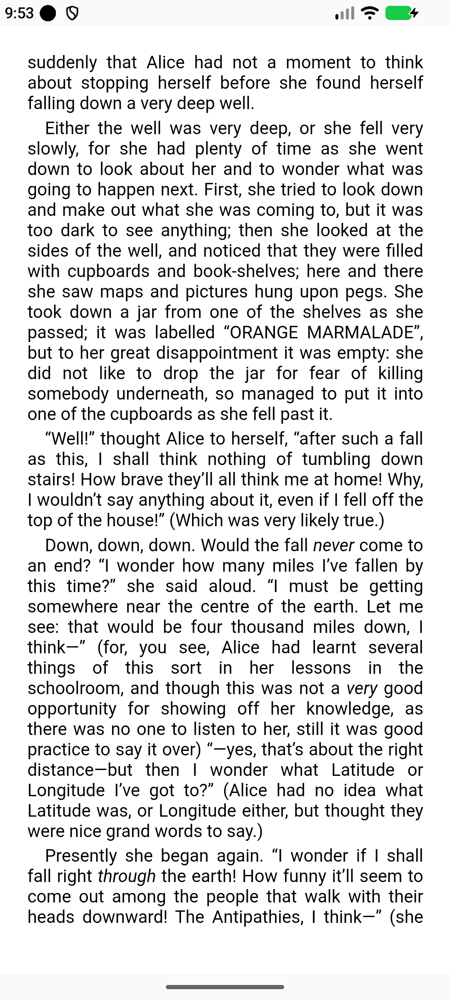

# M2 - first reader: milestone note

Branch `m1-m2`, emulator Medium_Phone (API 37, emulator-5554), `playBenchmark` build. Medians of 3 runs vs Must (C-015).
Gate: `bench/run_all.sh start open action mem`; failing groups were re-run once (bench/README.md). No app tuning was done to chase numbers.

 

## Gate result after Task 2.9 (commit 1effe1c; full run 20261031T060718Z, `start` re-run 20261031T061728Z)

Task 2.9 fixed the two red Must targets owned by M2 (P-016 passes; P-002 is still red, see below). "Before" = Task 2.8 final runs (2257dff).

| ID | Must | Runs | Median | Before (2257dff) | Result |
|----|------|------|--------|------------------|--------|
| P-001 cold start | 1200 ms | 865, 799, 788 (re-run: 819, 1165, 1128) | 799 | 817 | PASS |
| P-002 hot start | 250 ms | 85, 271, 345 (re-run: 413, 294, 55, median 294) | 271 | 366 | **FAIL** |
| P-010 Alice (tap to page) | 1500 ms | 778, 867, 769 | 778 | 861 | PASS |
| P-011 War and Peace | 1500 ms | 766, 718, 806 | 766 | 798 | PASS |
| P-012 2000 chapters | 2000 ms | 518, 468, 545 | 518 | 870 | PASS |
| P-013 200 images | 2000 ms | 836, 744, 776 | 776 | 728 | PASS |
| P-015 tap to reader frame | 100 ms | 12 values over 4 books, 17..32 | 23 | 27 | PASS |
| P-016 reopen score (C-023) | 1.0 | 0.650, 0.677, 0.797 | 0.677 | 1.585 | PASS |
| P-030 TOC jump | 700 ms | 250, 279, 227 (event cmd -> painted) | 250 | 480 | PASS |
| P-031 TOC panel, 2000 entries | 200 ms | 69, 71, 66 | 69 | 69 | PASS |
| P-060 memory, War and Peace | 215 MB | 162, 162, 161 | 162 | 174 | PASS |

P-016 per book, first open vs reopen (video ms): Alice 769-867 vs 172-229; War and Peace 718-806 vs 189-217; 2000 chapters
468-545 vs 260-319; 200 images 744-836 vs 184-249. Every reopen is under 400 ms (C-023).
`bench/check_resume.sh` (F-037/R-009): `resume: PASS`. `tools/smoke.sh`: OK.

### What Task 2.9 changed
- **P-016** (commit 1effe1c): the JS host keeps the last closed book's foliate view, laid out and hidden, instead of only its parsed
  package. Reopening the same session shows it again, moves it only if the requested position differs, and sends the usual
  `opened` -> `relocate` -> `painted`. Opening another book releases it (one warm book). Events, War and Peace: tap -> painted_first
  564 ms first open, 34 ms reopen. The video reopen times (170-320 ms) are mostly the harness (tap, screen recording, frame diff).
- **P-002** (commit ade3ade): when the activity stops while the home screen covers the reader WebView, the WebView turns INVISIBLE
  (still attached, layout kept) and turns VISIBLE again one frame after the first frame back. Before, the first frame of every hot
  start redrew it (atrace: extra `Record View#draw`/`syncFrameState` work; a WebView's first draw after being hidden costs
  100-180 ms here). Keeping it INVISIBLE on the home screen all the time was tried and dropped: making it visible again on the way
  into the reader put that cost into P-015 (126-515 ms) and stalls foliate's animation frames.
- Tests (commit 0d0b094): SmokeTest and ReaderFlowTest turn pages once the location has settled; they failed under host load
  before any Task 2.9 change (SmokeTest 3 of 3 runs on 2257dff).

### Failures and diagnosis
- **P-002 (still red).** 20 HOME / `am start -W` samples each, same session: before 362 ms median; with the fix 274-291 ms; with no
  WebView at all 309 ms; the M1 tip (c751058, no WebView, measured M1 median 152) 251 ms. So the WebView's share is gone, and what is
  left is the same for an app without it. atrace of a hot start (fixed build and M1 tip alike): the first resumed frame takes
  210-320 ms, nearly all in the system redraw after HOME: new window surface and buffer allocation (`dequeueBuffer`/`allocate`
  25-130 ms, `allocateBuffers` 20-120 ms), `syncFrameState` 40-110 ms and `eglSwapBuffers` 20-80 ms on SwiftShader (software GL).
  The values are bimodal (55-135 ms or 250-420 ms) with the same lifecycle events in both groups. The host was busier than during
  M1 (load 8-13 on 8 cores: emulator, Gradle daemons, the device panel's screen stream started after the M1 runs). Nothing app-side
  remains in the first frame; it needs a quieter host (or a GPU-backed emulator / real device) to be measured against 250 ms.
- **P-016** passes. Before: reopen 55-85 % of first open, 0.4-0.7 s (score 1.495-1.745), because the whole foliate open ran again.

### Before Task 2.9 (2257dff, kept for reference)
P-002 226, 387, 366 (first runs 292 median; 400, 274, ... 394 median), median 366, FAIL. P-016 1.585, 1.559, 1.745 (earlier 1.532,
1.613, 1.495), median 1.585, FAIL: Alice 770-932 vs 427-671, War and Peace 789-940 vs 558-763, 2000 chapters 556-883 vs 332-399,
200 images 704-751 vs 604-698 (first open vs reopen, video ms); `open_sent` -> `painted_first` about 750 ms on reopen vs 980 ms first.

## Harness deviations (documented, see commit)
- P-030: a headline on a white page changes the screen by less than 2 mean-abs-diff, so the recording method reports NA/47 ms. The value is the
  event delta command -> first `painted` (web-side paint); the video is kept and its value is in the note. The group also jumps to "BOOK ONE" before each
  run, because the book resumes at Second Epilogue after the previous run.
- `check_resume.sh` compares the last relocate after the 6 s wait, not the first: a transient relocate at the chapter start precedes the
  seek to the saved CFI (before `painted_first`).

## Known gaps by design
The huge-chapter book is slow until M8; boundary turns show a section load until M4; no page numbers until M4; library and scanning come in M3.
