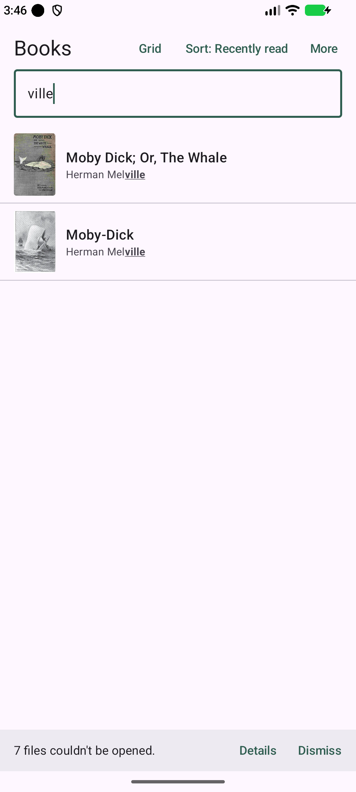
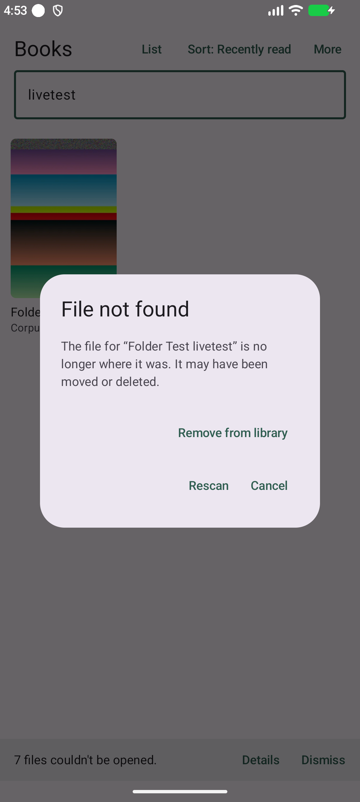

# M3 - Library and scanning: milestone note

Branch `m3` (from master cf4d47a), emulator Medium_Phone (API 37, emulator-5554). Plan:
`docs/plans/2026-10-31-mvp-m3-library.md`. Medians of 3 runs against Must targets only (C-015).

  

## Must targets (final code)

| Target | Must | Runs | Median | Result | Run |
|---|---|---|---|---|---|
| P-001 cold start to library | 1200 ms | 1076, 862, 935 | 935 | PASS | start, 3eda84c, quiet host |
| P-002 hot start | 250 ms | 118, 137, 153 | 137 | PASS | same |
| P-003 open-with to reader frame (warm) | 320 ms | 391, 231, 186 | 231 | PASS | same |
| P-050 first full scan, 60 files | 7000 ms | 846, 882, 778 | 846 | PASS | scan, 09f896c |
| P-050 first book visible | 500 ms | 243, 278, 283 | 278 | PASS | same |
| P-051 rescan, no changes | 300 ms | 236, 167, 217 | 217 | PASS | same |
| P-052 rescan after 14 new books | 1200 ms | 348, 109, 251 | 251 | PASS | same |
| P-060 memory, War and Peace | 215 MB | 180, 186, 185 | 185 | PASS | mem, 09f896c |
| P-010..P-013 open (M2) | 1500/1500/2000/2000 ms | see below | 769 / 718 / 700 / 704 | PASS | open, 3eda84c |
| P-015 tap to reader frame (M2) | 100 ms | 12 values, 17..35 | 27 | PASS | same |
| P-016 reopen score (M2, C-023) | 1.0 | 0.638, 0.785, 0.785 | 0.785 | PASS | same |
| P-030 TOC jump (M2, C-025) | 700 ms | 379, 359, 192 | 359 | PASS | action, 3eda84c |
| P-031 TOC panel, 2000 entries (M2) | 200 ms | 70, 22, 59 | 59 | PASS | same |

Open runs: P-010 801/769/769, P-011 716/741/718, P-012 984/700/597, P-013 704/735/649.
Results files: `bench/results/20261031T104214Z-09f896c.jsonl` (start, built from 3eda84c's tree before its commit),
`20261031T103705Z-09f896c.jsonl` (scan, mem), `20261031T104307Z-3eda84c.jsonl` (open, action).
3eda84c changes only the WebView reveal on return; scan and mem do not take that path.

Conditions: Gradle daemons stopped, device panel closed. `scan` runs `pm clear` before each run (a true first scan).
**T3's device-panel `ffmpeg` stream kept running after the device session was closed** (8-9 % CPU). With it running,
P-002 measured 319 (107, 329, 319) and P-003 355; after stopping that process, 137 and 231 (C-024). Recorded in the
bench README note below.

### What the gate found and what changed
- **P-050 first book visible 780 ms (first run).** Two causes, both fixed (4986c6d):
  - Room's change tracking waits for the writer connection, which the 4 scan workers hold until the scan ends. The library now also re-reads through a reader connection (every 150 ms) while books are added.
  - The WebView pre-warm (about 0.45 s on the main thread) ran before the first books were drawn. It now waits until the library has drawn its first books, or a first scan found none, with a 2 s cap.
- **P-060 222-233 MB.** M2's build on the same host today measured 171-174 MB. M3's app process had about 30 MB more native heap, from Coil's hardware bitmaps of the thumbnails, and cover decoding ran while a book was open. Fixed in 09f896c:
  - Coil uses software RGB_565 bitmaps with an 8 MB memory cache.
  - The cover queue pauses while a book is open.
  - In-memory covers are released when the reader opens.
- **P-003 440-606 ms after the open-with fix (one activity, review I4).** Making the hidden WebView visible inside the first frame was expensive. It is now revealed one frame after the first frame on every return (3eda84c).

## M2 carry-overs (Task 3.0, 34bccad)
- **Reader-event buffer.** It was a 256-entry DROP_OLDEST SharedFlow, so a burst while the controller waited on the database could drop an `opened`, a `seeked` or the last relocate. It is now unbounded; `ReaderEventsTest` sends 1000 events into a stalled collector.
- **Back during an open.** The opener now runs non-cancellably, and a session produced after Back is closed at once. Test: `ReaderControllerTest.back_while_opening_closes_the_session_that_was_being_opened`.
- **The flake: `ReaderFlowTest`.** It inferred page turns from timing. On a loaded host, foliate re-reports and refines the opening page after its first paint, and the test took that for the answer to a turn. Events are now ordered with a goTo/`seeked` barrier and a ping/pong flush.
  - Full instrumented suite after the fix: 29/29, 30/30 and the per-package runs green.

## Existing users' data (M2 → M3)
- **Picker books merge with their scanned files.**
  - M2 recorded picker books as `book` + a `content://` `book_file` + `reading_position`, with the identity built from foliate's identifier.
  - Schema v3 adds `scan_failure` via AutoMigration; `MigrationTest.v2_to_v3_keeps_books_files_and_positions` covers it.
  - `M2LibraryMigrationTest`: a v2 database holding such a book, whose OPF identifier contains newlines and tabs, migrates and is scanned. The result is one book with the old id, both files, and the unchanged position row (cfi and updatedAt).
- **Identity agreement.** `IdentityAgreementTest` (instrumented) opens 38 corpus books in the reader. The identity built from foliate's identifier equals the Kotlin `PackageLoader` identity for every book, plus for a generated book with whitespace inside its identifier.

## Final review (opus, whole branch) and fixes
1 Critical, 5 Important, 9 Minor. All Critical and Important findings were fixed with pinning tests.
- **C1. Hostile package (8 MB of nested or flat tags) → OOM or stack overflow → crash loop on every start.** Fix (946f3ac):
  - `XmlTree` caps depth at 256, elements at 200k and errors at 100; `descendants`/`text` are iterative.
  - The scanner maps VM errors to BROKEN_PACKAGE.
  - The app IO scope logs failures instead of crashing.
  - Tests: `XmlTreeTest` (3 cases), `ScannerTest.hostile_package_is_reported_and_scan_completes`.
- **I1. Opening a scanned book replaced its scan row.** A read book then never left the library when its file was deleted, and the scanner's sort keys were overwritten. Fix (12e6be0); test `ScannerTest.opened_scanned_book_still_leaves_when_deleted_and_rescans_cheaply`.
- **I2. Search and sort ran on the main thread.** They now run on Dispatchers.Default (4986c6d).
- **I3. Android 10 had scoped storage despite the grant.** Added `requestLegacyExternalStorage` (e80bb0a). Not checked on an API 29 emulator.
- **I4. Open-with while running created a second activity sharing one opener.** Now singleTask with `onNewIntent`:
  - while running, Back returns to the library and moves the app behind the caller;
  - on a cold open, Back finishes.
  - Test: `OpenWithTest.whileRunning_reusesTheActivity`.
- **I5. Cover decoding was unbounded for tall images; an OOM aborted the whole pass.** The sample is now set by both width and height, with a 4 MP cap. An OOM gives one book no cover; I/O failures are retried after the next scan.
- **Minors fixed (b6b58c6):**
  - An unreadable root or folder prunes nothing (M1).
  - A busy file keeps its entry (M2).
  - Books without an identifier are never merged by the same-path rule (M3).
  - No layout flash on start (M6).
- **Minors deferred:**
  - Cover staleness after an in-place change; orphan thumbnails (M7).
  - Open-with `sameFileResumes` and the corpus malformed set via open-with (M9 robustness suite).
  - Walker stat calls (only if P-051 tightens).
  - Open-with `content://` entries whose grant could not be persisted (M7).
  - Open-with state after process death (M6).
  - SmokeTest keeps "Back leaves the reader" rather than "lands on the library", because it does not grant storage access and onboarding is a valid bottom route.

## Deviations from the plan
- **Execution.** Task 3.0 ran under a subagent. After that, the user asked to stop it and speed up. Tasks 3.1-3.10 ran inline (executing-plans), with one whole-branch review at the end instead of per-task reviews.
- **ScanController and SettingsStore** live in `core:data`, so they can be host-tested; the plan put ScanController in `app`.
- **Covers** are filled after each scan completes, not per added book, and are paused while reading.
- **Dropped instrumented tests:**
  - `LibraryScreenTest`: the logic is host-tested in `LibraryStateTest`, and the screen was checked on the emulator (screenshots).
  - `MissingFileTest`: F-018 is covered by host tests plus a manual check on the emulator (dialog shown at once; Remove deletes the entry; screenshot). The reviewer partly disagreed; restoring it is cheap.
- **OnboardingTest** replaces the storage check with an override. Changing MANAGE_EXTERNAL_STORAGE makes the system kill the app, and the test runs inside it. The real system permission screen was not driven by hand in M3.
- **C-009 position re-validation is not built.** The master plan specifies "unresolvable → nearest valid position in the same chapter, done in the reader host on open". The same book (by identifier) at the same path keeps its id and position, but if the position no longer resolves, foliate falls back to the book start, as in M2. Proposed for M4 together with the reader-host work.
- **Library-only search and sort, no folder-scope UI.** The scanner and the `library.scope` setting support F-011; the folder picker UI is M7 (master plan).

## Questions for the gatekeeper
- **Q1 - P-050's file count.** performance.md says "58 files"; the device has 60 `.epub` files, because two extra test files sit in `Books/local` and `Books/generated`. The first scan takes 846 ms, so this changes nothing. *Proposed:* accept the pushed set (corpus + folder set + local test books) as the P-050 set.
- **Q2 - Measurement condition for P-002/P-003.** T3's device-panel ffmpeg stream outlives the device session.
  - With it running: P-002 319 and P-003 355 (both FAIL).
  - Stopped: 137 and 231 (both PASS).
  - *Proposed:* C-024's "screen streaming off" means no device-stream process at all. bench/README now says to check `pgrep ffmpeg` before `start`.
- **Q3 - C-009 position re-validation** (see Deviations). *Proposed:* M4 Task 4.1 (reader host), with a test that moves a saved CFI past the end of its chapter.

## Known gaps by design
- No live file watching in the library: it rescans on start and on resume (debounced 2 s), plus manual Rescan (F-012 allows this).
- No book details, folders, collections or hidden books (M7).
- Covers of changed books are not refreshed (M7).
- Library-wide navigation (drawer) is M7. M3 reaches all books, rescan and open-book.

## How to try it
The debug build is installed on Medium_Phone with all-files access granted, and the corpus and folder set are on shared storage. Launch "EPUB Reader": the library shows covers.
- **Library actions:**
  - "List"/"Grid" switches layout.
  - "Sort" chooses recently read / date added / title / author.
  - The search field filters as you type (try "ville").
  - "Details" on the bottom bar lists the 7 files that could not be opened.
  - "More" → "Rescan" or "Open book".
- **Opening a book:** tap a cover. Back returns to the library, and the book moves first under "Recently read".
- **From a terminal (fish):**
  ```fish
  adb shell am start -a android.intent.action.VIEW -t application/epub+zip -d file:///sdcard/Books/gutenberg/frankenstein-epub3.epub -n app.epubreader/.MainActivity
  ```
  This opens a book as open-with. Back leaves the reader.
