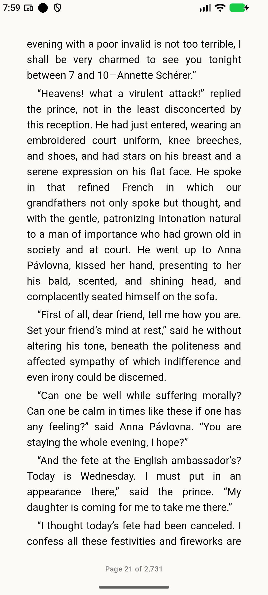
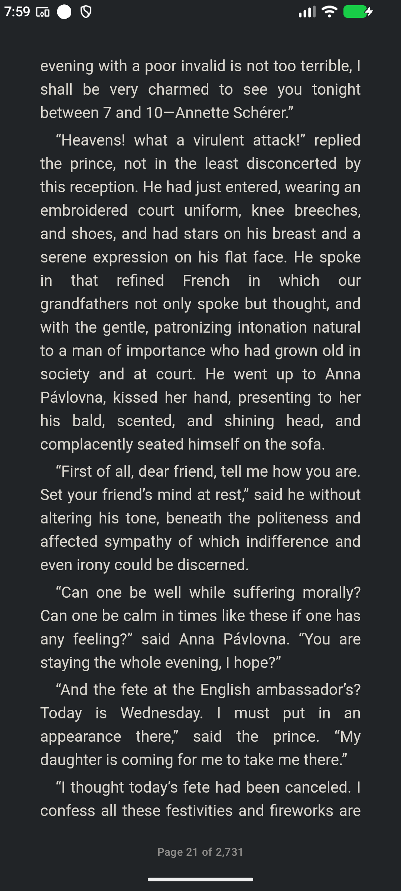
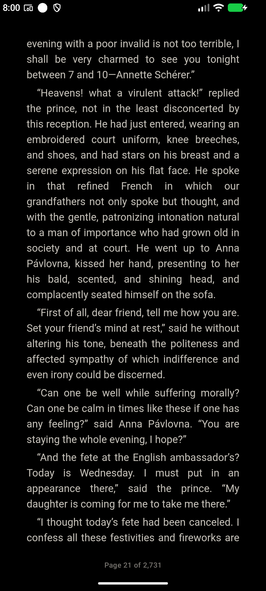
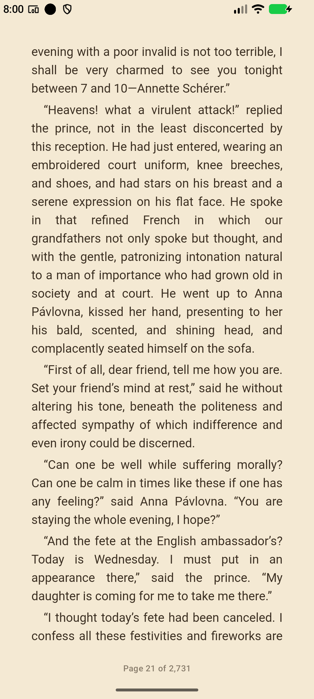
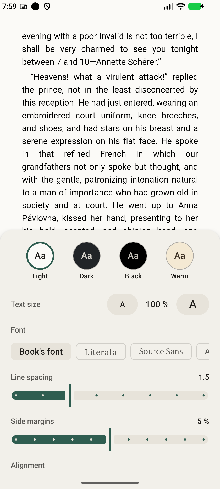

# M4 - Reading comfort and page numbers: milestone note

Branch `m4` (from master 4c8767c), emulator Medium_Phone (API 37, emulator-5554). Plan:
`docs/plans/2026-10-31-mvp-m4-reading-comfort.md`. Medians of 3 runs against Must targets only (C-015).

| Light (default) | Dark | Black | Warm | Display panel |
|---|---|---|---|---|
|  |  |  |  |  |

## Must targets (final code)

Benchmarks ran on 4f4832e. The only later change, 9c598fb, removes `color-scheme` from the reader style sheet: it changes paint colour in the Dark and Black themes and has no timing effect.

| Target | Must | Runs | Median | Result | Notes |
|---|---|---|---|---|---|
| P-020 text size → reflowed page (W&P, panel open) | 100 ms | 123, 76, 90 | 90 | PASS | Re-run (bench rule). First run 119, 143, 110 (FAIL); see Q2 |
| P-021 layout change → exact total (W&P) | 5000 ms | 2846, 2784, 3048 | 2846 | PASS | Text size +1/−1/+1 step |
| P-021 estimate error | 5 % | 0.62, 0.11, 0.62 | 0.62 | PASS | ≈ 3,223 vs 3,243; ≈ 2,734 vs 2,731 |
| P-022 rotation (W&P) | 900 ms | 390, 484, 387 | 390 | PASS | Recording from the command marker |
| P-026 boundary turn (W&P) | 400 ms | 106, 119, 114 | 114 | PASS | Medians of 5 turns per run; all 15 turns 44–277 ms |
| P-026 blank frames | 0 | 0, 0, 0 | 0 | PASS | S2 ink rule, 15 turns |
| P-060 memory, W&P | 215 MB | 200, 198, 198 | 198 | PASS (steady) | Right after the turns: 334 MB; see Q1 |
| P-001 cold start | 1200 ms | 873, 939, 898 | 898 | PASS | Quiet host: Gradle stopped, no ffmpeg (C-028) |
| P-002 hot start | 250 ms | 127, 255, 62 | 127 | PASS | Same |
| P-003 open-with | 320 ms | 353, 176, 134 | 176 | PASS | Same |
| P-010..P-013 open | 1500/1500/2000/2000 ms | see below | 801 / 800 / 871 / 758 | PASS | |
| P-015 tap → reader frame | 100 ms | 12 values, 17..33 | 21 | PASS | |
| P-016 reopen score (C-023) | 1.0 | 0.875, 0.790, 0.641 | 0.79 | PASS | |
| P-030 TOC jump (C-025) | 700 ms | 397, 345, 405 | 397 | PASS | |
| P-031 TOC panel, 2000 entries | 200 ms | 27, 23, 58 | 27 | PASS | |
| P-050 first full scan / first book | 7000 / 500 ms | 519, 586, 478 / 260, 195, 46 | 519 / 195 | PASS | |
| P-051 rescan, no changes | 300 ms | 189, 271, 259 | 259 | PASS | |
| P-052 rescan, 14 new books | 1200 ms | 74, 28, 285 | 74 | PASS | |

**Open runs:**
- P-010: 801, 866, 726
- P-011: 716, 800, 1147
- P-012: 702, 871, 936
- P-013: 757, 821, 758

**Results files** (`bench/results/`):
- `20261031T133637Z-4f4832e.jsonl`: `start`
- `20261031T133729Z-4f4832e.jsonl`: `action`, `pagetotal`, `mem`, `open`, `scan`
- `20261031T135325Z-4f4832e.jsonl`: the P-020 re-run

**Not gated, measured once:**
- **A page turn while the counter runs** (review I3): 519–531 ms from command to `painted`, against 473–508 ms idle. Both include the 300 ms slide, so a count adds about 20–50 ms to a turn.
- **First count after opening War and Peace:** the exact total arrives about 3.0 s after the first page.

## What works

Each item names its spec ID and the test that covers it.

- **Boundary turns (P-026):** the next and previous chapters are laid out in advance, so a turn across a chapter boundary is an instant swap with no blank page.
  - A highlight added while a chapter is preloaded is drawn, and is still there after the swap.
  - Tests: `ReaderBoundaryTest`.
- **Display panel (F-075):** a bottom panel over the page, in the active reading theme. Every change previews live. It holds:
  - four themes: Light, Dark (dark grey), Black (OLED) and Warm;
  - text size from 80 % to 260 % in 10 % steps;
  - font: the book's own, Literata, Source Sans 3 or Atkinson Hyperlegible, each shown in its own face (all SIL OFL 1.1, licences in `assets/reader/fonts` and `docs/licenses.md`);
  - line spacing 1.3–2.0, side margins 0–10 %, alignment (as published / left / justified);
  - reading mode (pages / scroll / auto), page-number scope (book / chapter), brightness with a System switch.
- **Text size (F-070):** every step keeps the first visible paragraph on screen. `ReflowTest` checks all 36 steps on War and Peace.
- **Themes (F-074):** the page, its margins, the status- and navigation-bar strips and the bar icons all follow the theme.
- **Scroll mode (F-031):** chapters are stacked, so scrolling continues from one chapter straight into the next. Adding a chapter above the screen does not move the text. Auto means pages in portrait and scroll in landscape (C-004). Tests: `ScrolledFlowTest`.
- **Rotation (F-037, P-022):** rotating to landscape and back returns the same CFI, in paged and in auto mode. Tests: `RotationTest`.
- **Page indicator (F-034, C-002, C-016, C-017):**
  - The label always shows in the bottom margin: first "Page N", then "Page N of ≈ M" within about 0.4 s, then the exact total.
  - Chapter scope shows "Page N of M in chapter".
  - The seek slider sits in the chrome.
  - Scroll mode shows the paged-mode number for the same place.
  - Tests:
    - `PageIndicatorTest`: War and Peace at +10 % goes 22 → ≈ 3,224 → exact 3,243.
    - `PageCountAgreementTest`: 92/92 sections agree with the reader's own count at 100 % and 140 %, plus an RTL book.
- **Saved positions (C-009/C-029):** a saved position that no longer resolves opens at the nearest valid place in its chapter. `PositionFallbackTest` moves a position past the end of its chapter.
- **Section stats:** text sizes per section are extracted after the first paint and cached in `book_cache` (schema v4, AutoMigration).

## Bugs found on the way (fixed, with tests)

- **Image-only page hang (also on master):** a position saved on an image-only page, such as War and Peace's cover, left the next open on the loading screen forever. foliate does nothing for an anchor with no layout box. Test: `PositionFallbackTest.position_on_an_image_only_page_opens`.
- **Spike paginator patch:** a jump left the previous chapter's slot cached with a destroyed view, which would show a blank swap and leaked memory.
- **Shared section resources (review I1):** foliate counts a top-level section's resources only once. The page counter's load/unload therefore revoked resources that the visible and preloaded chapters still used. After a text-size change the recount took 15 s and memory reached 393 MB; it now takes about 3 s.
- **Dark and Black themes:** the page showed a darker `#121212` box. A frame with a different `color-scheme` from its host page gets an opaque canvas.

## Final review (whole branch, separate reviewer) and fixes

Result: no Critical, 5 Important, 4 Minor. One Minor (7) was re-graded to Important. Every Critical and Important finding was fixed; each fix is listed with its test.

| # | Finding | Fix | Test |
|---|---|---|---|
| I1 | Counter's load/unload revoked blobs in use (foliate refcount) | `shareSections`: one reference count per section for all users; real unload after the real load | `sections.test.ts` (4) |
| I2 | RTL boxes counted as 1 page | `boxPages` measures in either direction | `counter.test.ts` boxPages; RTL book in `PageCountAgreementTest` |
| I3 | Turns blocked while a batch runs; not measured | Count starts 400 ms after a change, after the reflow paint; measured above (+20–50 ms) | Measurement above |
| I4 | Neighbour evicted while loading leaked | Release after the load completes; preload stops if evicted | `sections.test.ts` evicted-while-loading |
| I5 | Page label over text in scroll mode | Label on a page-colour strip | Checked on screen (no Compose UI test setup) |
| 7 (re-graded) | Vertical books showed no page number at all | Section list sent, so the page number shows (no total yet) | `PageIndicatorTest.vertical_book_shows_a_page_number` |

**Minors deferred:**
- A NaN stored in the settings resets every setting, not just that field. There is no crash.
- `marginPercent` stored as `5.0` falls back to the default.
- In scroll mode, small position shifts are possible while a new chapter is added during a fling. This is untested and needs a real device (M9).
- `clampToRange`: an offset exactly at the end of one of several adjacent text nodes lands at the end of the block.
- An evicted view that was still loading can still send `load`/`create-overlayer` events.
- `book_cache` rows are not deleted with their book (M7, delete).

Full suite on the final code (9c598fb): `./gradlew check` green, Vitest 87/87, instrumented 44/44.

## Deviations from the plan

- **Execution:**
  - Inline (executing-plans) rather than subagent-driven, as in M3, with one whole-branch review at the end.
  - Rulings are recorded in the ledger. The main ones are below.
- **F-035:**
  - Built in M4: the brightness slider with a System switch, since F-075 lists brightness.
  - Left for M6 Task 6.2 (master plan): fullscreen, keep-screen-on and orientation lock. System bars stay visible and are themed.
- **Settings fields:** only the fields M4 uses. The M6 input fields (animation, tap zones, volume keys, swipe direction) come with M6. Unknown fields decode to their defaults.
- **Estimates:** the S1 decision is applied in full.
  - When an earlier layout has a complete count, those counts are scaled: by the visible chapter's ratio until the sample arrives, then by the sample's ratio. The text model is used only when no earlier count exists.
  - The plan's Task 8 text named only the text model. With it, the page number dropped to 9 instead of 20 after a font change.
- **Counter:**
  - The full batched counter landed with Task 8.
  - Sections share a batch when their head style sheets and `html`/`body` attributes match; the batch copies those attributes. Other sections are counted alone in a foliate View.
  - The plan's rule ("body has attributes → alone") would have put the whole of War and Peace, whose bodies all have a class, in the slow path.
  - Sections are cut from their text, without building a DOM, to save memory.
- **Scroll test:** it uses slow drags, not a fling. Emulator flings have no reliable momentum: 392 px in one run, two chapters in the next.
  - `cfi_round_trip_at_slot_boundary` was not written.
- **Bench methods:**
  - P-021 is the event delta from the command to `page_total_exact`.
  - P-022 rotates with an app-requested orientation (a real configuration change), recorded from the command marker.
  - P-060 is gated on steady reading (Q1).
  - Details are in `bench/README.md`.

## Questions for the gatekeeper

### Q1 – When is P-060 measured?
- After an open or a layout change, the page counter lays out the whole book once.
- The WebView renderer keeps about 110–140 MB of that memory until it releases it, about 25–30 s later.
- Measured right after the bench's 20 page turns (about 23 s after the open): 334 MB.
- Measured 35 s later: 198–200 MB. Without the counter: 182 MB. M3: 185 MB.
- performance.md says only "memory while reading War and Peace".
- **Proposed:** gate the steady reading value; the transient peak is not gated for War and Peace.
- If the peak must also be ≤ 215 MB: counting from the raw section text instead of foliate's loaded documents saved about 50–70 MB in a measurement. That is about a day of work, in M5 or before M9.

### Q2 – P-020 is close to its limit on this emulator
- First run: 119, 143, 110. The re-run allowed by the bench rules: 123, 76, 90.
- Inside the web view, the reflow and paint take 30–120 ms. The recording also includes the panel's own update.
- **Proposed:** accept the re-run and confirm on the real device in M9.

### Q3 – Vertical-writing books (F-081)
- These books show the page number (estimated from text size) but no book-wide total. The batched counter mirrors horizontal pagination only.
- **Proposed:** count vertical books one section at a time in a foliate View (exact, slower; C-016 sets no time limit for books other than War and Peace) together with M6's F-081 work.

### Q4 – F-035 scope
- M4 has the brightness controls only. Fullscreen, keep-screen-on and orientation lock follow the master plan's M6 Task 6.2.
- **Proposed:** keep this split.

## Known gaps by design

- No book-wide total for vertical-writing books (Q3).
- Corpus-wide page-count agreement and the ±5 % estimate check for every book are M9 release checks (C-020).
- RTL boxes in this book's batch lay out left-to-right, so the instrumented RTL case cannot tell the old count formula from the fixed one. The unit test pins the right-to-left arithmetic.
- No fullscreen yet (M6).

## How to try it

The debug build is installed on Medium_Phone with all-files access and opens on the library.
- **Change the display:**
  1. Open a book (try "War and Peace").
  2. Tap the middle of the page to show the bars.
  3. Tap **Display**.
  - Themes, text size, fonts, spacing, margins and alignment change the page live.
  - **Reading mode → Scroll** continues from chapter to chapter. **Auto** scrolls in landscape.
- **Page numbers:**
  - The page number is at the bottom of the page.
  - After a text-size change it shows "Page N" for a moment, then "of ≈ M", then the exact total, about 3 s later on War and Peace.
  - The slider in the bottom bar seeks through the book.
  - **Page numbers → This chapter** switches to chapter pages.
- **Rotate the emulator:** the passage stays on screen.
