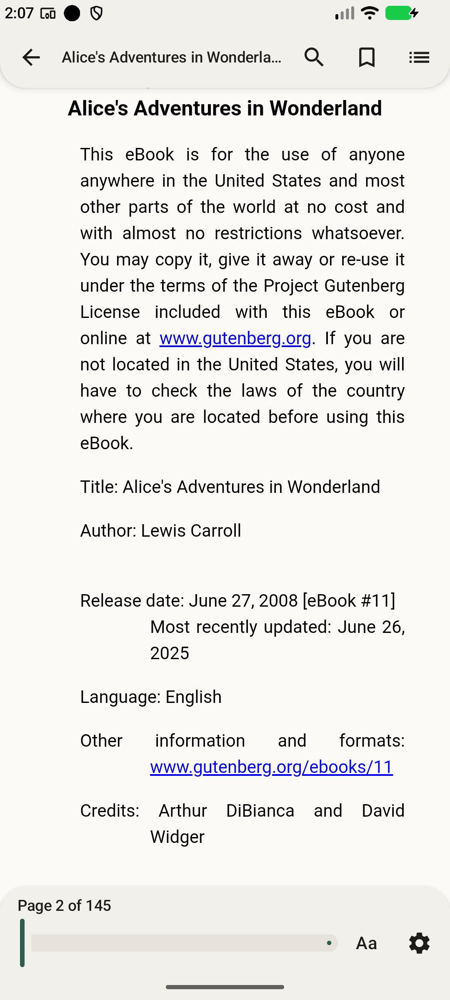

# M6 - Interaction and annotations: milestone note

  

Branch `m6` (from master 9e76afb), Track A (C-035), emulator Medium_Phone (API 37, emulator-5554). Plan:
`docs/plans/2026-10-30-mvp-plan.md`, section "M6 — Interaction and annotations". Must targets only (C-015); benchmark
scope per C-034 (no new M6 timing gates): P-001, P-002, P-010, P-011, plus P-020 and P-026.

## Tasks

- [x] Data layer: M6 settings fields, schema 7 (`bookmark`, `annotation`, AutoMigration 5→7), stores
- [x] 6.1 Controls overlay (full control set) and reader settings sheet
  - Top bar: back, chapter title (book title below), search, bookmark, contents; bottom bar: page label, seek slider,
    display, reader settings. Icons from `material-icons-core` 1.7.3 (Apache-2.0); the bookmark icon is drawn by hand
    (not in the core set). The Reader settings sheet holds every M6 setting until M7's Settings screen exists.
- [x] 6.1 Page-turn input: swipes through the queue (C-026), tap zones, volume keys (C-005), animation, direction (F-081)
  - Deviations: swipes are recognised by the host and queued like bridge turns, so in paged mode the page no longer
    follows the finger while dragging (each swipe is one slide; a second swipe during the animation is kept, C-026).
    Tap zones mirror like swipes for right-to-left books (left edge = next). An edge tap while the controls are shown
    hides them. Volume keys: one page per press (auto-repeats are consumed without turning); the key is consumed only
    on the reader route with no panel open, so media volume is untouched.
  - Task 3 question resolved in Task 9: vertical-rl sections are now paged right-to-left as horizontal pages (paginator `vertical-pages` patch: multicol rows with CSS `column-wrap`, one row per page); "next" brings in the page on the left with the slide in that direction, swipes/tap zones as Task 3 mapped them (rightward = next; upward still also = next), relocate/CFI/resume and preloaded vertical neighbours work (VerticalWritingTest). Needs `column-wrap` (Chromium 145+; the emulator's WebView is 158); an older WebView keeps foliate's top-to-bottom pages without a book total. Scrolled flow for vertical books is unchanged (foliate scrolls them sideways; not re-checked visually).
- [x] 6.2 Screen behaviour: fullscreen, keep-screen-on, orientation lock (C-033)
  - Fullscreen hides the bars while the controls are hidden and shows them with the controls; the page is inset by a
    stable amount (display cutout only in fullscreen), so neither reflows it; bars swiped in transiently overlay the
    page. Error screens show the bars and do not keep the screen on. Orientation locks follow the sensor (either way
    up). The window is applied one frame after the reader's first frame (P-015, see below).
- [x] 6.3 Links, back history, footnote popups, external links
  - Task 5 deviations: the footnote popup is a plain overlay `div` (role="dialog") in the host page, not a `<dialog>` element; "hide aside footnotes from the main flow" (optional) not done (would change pagination and page counts); TOC/search/slider jumps create no Back-history entries (only followed links do); external schemes allowed: http, https, mailto only.
- [x] 6.6 Bookmarks
  - Contents | Bookmarks | Highlights tabs in one panel (always reachable, also for books without a TOC). The list
    shows "Page ≈ N" from the bookmark's book fraction against the current total (a percentage before a total exists).
    A bookmark stores the page's range CFI; the page marker is hidden while the controls show (the filled button says
    it). Removal from the list is immediate with a confirmation.
- [x] 6.4 Selection menu (F-060, F-051 "Search in book")
  - Task 7 deviations: `addAnnotation` also carries `sessionId` (book-scoped like `setBookmarks`); highlight colour choice is one Highlight item (last-used colour, default yellow) plus a colour row shown after it (6 swatches, one more tap recolours), because the floating toolbar shows titles only (no coloured icons); new setting `highlightColor`; annotations made earlier are not yet redrawn on open (Task 8); `ReaderController` takes a `positionMap` factory (identity) so the original/virtual CFI split is host-tested.
- [x] 6.5 Highlights, notes, annotations list
  - Task 8 deviations: the search hit (F-050) is now an orange outline instead of a fill, so the user's orange highlight can never be mistaken for it; highlight fill opacity 0.4 on the dark/black themes (0.3 light/warm); Remove has an Undo snackbar (restores as a new row: same range, text, colour, style, note); "view full note" expands in place; editing colour in the sheet does not change the default colour; a tap on a link inside a highlight follows the link.
- [x] 6.7 Rendering compatibility screenshots; vertical-writing page totals per chapter (C-032)
  - Task 9 deviations: C-032 vertical books are counted one section at a time in a hidden foliate View (exact, "≈ N" after the 12-section sample); fixed-layout books could not open since M4 (`setStyles` missing on foliate's FXL renderer) and could not be turned by swipe at all: both fixed; `<mfenced>` (not in MathML Core) is rewritten before layout so matrix brackets show; two bench commands added (`tocIndex`, `searchHit`) for tools/run_checks.sh.
- [x] Benchmarks, whole-branch review, full instrumented suite

## Must targets (final code 2f5e1ff; scope C-034 + P-020, P-026)

Host under heavy memory pressure during the whole run (≈ 14 GB swap in use, emulator at 29 h uptime with its own swap
full; the emulator was rebooted once). Master 9e76afb was benchmarked in the same session for comparison.

| Target | Must | m6 median (runs) | master same session | Result |
|---|---|---|---|---|
| P-001 cold start | 1200 | 852 (and 900, 733, 879 on reruns) | 896, 756 | PASS |
| P-002 hot start | 250 | 262 (262, 359, 233); earlier 279, 320, 264 | 297, 318 | FAIL — environment, see Q5 |
| P-010 open Alice | 1500 | 955 | 818 | PASS |
| P-011 open War and Peace | 1500 | 1068 | 945 | PASS |
| P-020 text size reflow | 100 | 169, re-run 193 (first run 124) | 123 (same method, interleaved) | FAIL — environment, see Q6 |
| P-026 boundary turn | 400, no blank frame | 119, re-run 123; 0 blank frames | — | PASS |

Also measured: P-012 870, P-013 997, P-015 41.5, P-016 0.855, P-030 413, P-031 68 — all PASS; P-022 1458 FAIL
(harness artefact, Q7); P-003 270-326 (master 308-320).

**Regression found and fixed:** the first open run read P-015 = 465 ms (master 34). Since M6 the reader window
(hiding the system bars) was applied in the same frame that first drew the reader; the bars' inset animation made the
next frame wait 150-450 ms for the WebView's first draw. The window is now applied one frame later (2f5e1ff, pinned by
ScreenBehaviourTest and ReaderWindowStateTest): P-015 41.5 ms, P-012 back from 1044 to 870. Also: the window is no
longer re-applied on every page turn or on a library hot start (8ab8af8, review I2).

## Other checks on the device

- Instrumented suite, final code 2f5e1ff: **78/78 pass** (`am instrument`, all classes, 570 s), including the new
  ControlsOverlayTest, PageTurnInputTest, ScreenBehaviourTest, LinksFootnotesTest, BookmarksTest, SelectionMenuTest,
  HighlightsTest, VerticalWritingTest.
- Host: core:data, ui, app unit tests and `./gradlew check` (lint) pass; Vitest 251 pass, `tsc` clean.
- Whole-branch review (9e76afb..3df09e0): no Critical, 4 Important — fixed with pinning tests: Contents (so bookmarks
  and highlights) unreachable in a book without a TOC; window flags re-applied on every page turn; a note being typed
  lost if the app is killed in the background (now stored on stop); Back with a text selection left the book (now
  clears the selection). Minors fixed: bookmark section index stored in virtual coordinates, footnote-popup links lost
  their query, error screens kept the screen on, landscape lock was one rotation, multi-row changes not in one
  transaction, Contents panel title. Scoped re-review: all addressed.

## Known gaps (parked review minors, for later milestones)

- A warm reopen does not erase web-side drawings that became stale while the book was closed (rare: edits happen in
  the open book).
- Vertical-rl books without `page-progression-direction="rtl"`, and books mixing writing modes: the page counter picks
  its mode from the first section shown.
- Quick successive sheet edits can flicker once (an older database emission).
- Superscript-link footnote detection parses the target section on every tap (no cache).
- Bookmark/highlight creation uses the last relocate; a tap during a turn animation records the previous page.
- The selection reaches Kotlin ~120 ms after it settles; a menu tap right after dragging a handle could act on the
  previous selection (not seen on the device). Our menu items come first because the WebView's own items have orders
  ≥ 1 (true on API 37).
- `reader-web/test/reader.test.ts` waits a fixed 40 ms and can flake under heavy host load.

## Rendering compatibility (6.7)

Run: `tools/run_checks.sh` (benchmark build of the code at 6d2cd07, emulator-5554 portrait, default settings, each case
from a cleared app: no resumed position), 2026-11-01. Screenshots (540 px wide) and per-case warning logs in
`docs/milestones/M6-checks/`; every PNG reviewed by eye. Logcat: no AndroidRuntime/crash lines in any case; the only
EPRJS warnings are the expected ones (bad-XML chapter parse error before the lenient re-parse, the spine item "ghost"
without a manifest item, the script-test book's blocked inline script).

| Case | Spec | Expected | Result | Note |
|---|---|---|---|---|
| rtl-arabic | F-081 | text right-aligned, rtl | PASS | Arabic right-aligned, headings on the right |
| vertical-ja-a / -b | F-081, C-032 | vertical with ruby, pages progress right-to-left | PASS | consecutive pages 77/78: page b continues the text that ended at the left edge of a; ruby shown; exact total "of 206" |
| vertical-ja-toc | F-080 | TOC works | PASS | 一..十三 + この文書について |
| fxl-page-blanche | F-082 | whole page, no crop | PASS | page fitted (spine item 2 is the book's deliberately white page, so the shot is after two turns) — FAILED before the fix (see deviations) |
| fxl-haruko-a / -b | F-082 | whole page, no crop, rtl progression | PASS | manga pages fitted; next follows the spine; a rightward swipe is next (PageTurnInputTest) — FAILED before the fix |
| mathml / mathml-2 | F-083 | MathML renders, matrices | PASS (note) | inline math italic, `[A │ b]` and the 3×4 augmented matrix with its brackets after the `<mfenced>` fix (before: no brackets at all); the brackets do not stretch to the matrix height (no math font, Q2) |
| font-obf | F-083 | book's typeface (obfuscated OTF) | PASS | Old Standard shown (high-contrast serif, its italic in "Od' und leer das Meer") |
| font-woff | F-083 | book's typeface (WOFF) | PASS | same face as font-obf |
| svg-spine | F-083 | SVG spine document renders | PASS | the CC poster SVG — FAILED before the FXL fix (pre-paginated book) |
| svg-spine-2 | F-083 | SVG spine document renders | PASS | "SOUS LE VENT" title page — FAILED before the FXL fix |
| epub2-ncx-toc / epub2-ncx | F-080 | opens, NCX TOC works | PASS | TOC lists the NCX chapters; entry 4 jumps to "Chapter 4" |
| script-test | R-007 | book scripts do not run | PASS | heading still "SCRIPTS ARE OFF" (script blocked: CSP + sandbox) |
| bad-xml-good / -good2 | R-001 | both good chapters readable | PASS | page 1 and page 10 of 14 |
| bad-xml-bad | R-001 | bad-XML chapter text visible | PASS | lenient parse: "&bogus;", stray "&", mis-nested bold/italic shown |
| bad-xml-missing | F-084, R-001 | placeholder for the missing chapter | PASS | "This part of the book is missing…" + item path, in flow between the chapters |
| bad-xml-toc-missing | R-001 | TOC entry to the missing file: notice, stays | PASS | entry greyed, notice shown, panel stays |
| malformed-broken-opf | R-002 | clear message, no crash | PASS | "This book can't be displayed." + XML parse detail |
| malformed-no-container | R-003 | report (no OPF in the file) | PASS (note) | "This book can't be displayed. Failed to load container file" (Q4) |
| malformed-not-a-zip | R-002 | clear message, no crash | PASS | "This file isn't an EPUB book." |
| malformed-truncated | R-002 | clear message, no crash | PASS | "This book file is damaged and can't be opened." |
| malformed-empty-spine | R-002 | clear message, no crash | PASS (note) | headline clear, detail line is a raw script error (Q3) |
| fake | R-004 | reported, no crash | PASS | "This file isn't an EPUB book." |
| stress-200-images | F-085 | each plate fitted on the page | PASS | plate 42 scaled down to the page with its caption |

Not covered by this run: opening via ACTION_VIEW (the run opens by path through the bench receiver; R-002's open-with
path was not exercised), landscape spreads (F-082 Later), scrolled flow for vertical books.

## Rebase onto M7

M6 was rebased onto master 3487f72 (M7: Settings screen, backup and restore, collections, schema 6).

- **Schema 6 → 7:** `bookmark` and `annotation` are added by `AutoMigration(6, 7)` on top of M7's schema 6. A database
  from the pre-rebase v7 (unreleased) is not migrated: clear app data on development devices (C-044).
- **Settings moved (F-100):** the M6 reader settings are also on M7's Settings screen (`settingsSections`): "Reading"
  (page numbers, page-turn animation, swipe direction, tap zones, volume keys with the C-005 summary), "Screen"
  (fullscreen, keep screen on, orientation lock) and "Links" (external-link confirmation). They edit the same
  `ReaderSettings` through `ReaderController.updateSettings`, as the reader's Reader settings sheet (unchanged) does. A
  restore re-reads the whole `ReaderSettings`, M6 fields included. Tests: `SettingsEntriesTest`, instrumented
  `SettingsReaderItemsTest`.
- **Backup extended (F-090, C-041, still format version 1):** the file has `bookmarks` and `annotations` (highlights,
  underlines and notes, every column), tombstones included; M7's empty `highlights` placeholder is no longer written
  and is ignored on parse like any unknown key. Both new keys are optional, so an M7 file restores unchanged. Restore
  merges per row id in the same transaction as the rest: the newer `updatedAt` wins, equal keeps the local row, so a
  newer tombstone deletes and an older one is ignored. Rows follow the positions rule for their book: the matched or
  pending (not on this device) book, else skipped. Restored stamps are bounded and seed the clock like the M7 tables.
  The open reader's lists follow a restore (Room flows). Search history is not backed up (C-043). Tests:
  `BackupAnnotationsTest` (new frozen fixture `backup/v1-annotations.json`; `v1.json` unchanged), instrumented
  `BackupRestoreTest` (F-090 check with a bookmark and a note; a restore into the open reader).

## Questions for the gatekeeper

- **Q1 (Task 9) Vertical pages need CSS `column-wrap`.** Right-to-left vertical pages (F-081) and their page totals (C-032) use Chromium's multicol `column-wrap` (Chromium 145+; emulator WebView 158). On an older WebView the reader falls back to foliate's top-to-bottom vertical pages with no book total (as before M6). Proposed default: accept (WebView updates through the Play Store); recheck on the real device before release.
- **Q2 (Task 9) MathML fences do not stretch.** linear-algebra's matrices now have their brackets, but at text size, not the matrix height: Android ships no font with an OpenType MATH table, so the WebView cannot stretch `<mo>`. Proposed default: bundle Noto Sans Math (SIL OFL 1.1, about 1 MB) for `math` elements (also excluded from the reader's font override) in M8 or M9; until then accepted as "MathML renders".
- **Q3 (Task 9) Empty spine shows a raw error detail.** `malformed-empty-spine` gives "This book can't be displayed." plus "Cannot destructure property 'parentNode'…" (foliate fails before our "no readable sections" check). Proposed default: map a package with no spine items to the existing no-readable-sections message (M9 polish).
- **Q4 (Task 9) No-container wording.** `malformed-no-container` (no container.xml, no OPF) is reported as "Failed to load container file"; R-003 prefers "no package found" and a fallback search for a single OPF. Proposed default: add the single-OPF fallback and a "No package found in this file" detail in M9.

- **Q5 P-002 hot start on this host.** m6 262 ms (runs 262, 359, 233; earlier runs 279/320/264) against a Must of
  250; master 9e76afb in the same session read 297 and 318, and M5 measured 103 on a quiet host. The host was swapping
  (~14 GB) throughout. Proposed default: no M6 regression (m6 ≤ master in the same session); re-measure P-001..P-003 on
  a quiet host at the M7 full-suite run (C-034) and on the real device.
- **Q6 P-020 on this host.** m6 169 / 193 ms (first run 124), master 123 interleaved in the same session with the same
  method (both over the 100 ms Must; M5 passed on a re-run at 76-123, C-031). Text-size changes touch no M6 code path
  (no window change, annotations redraw only for drawn sections). Proposed default: accept as host-bound for M6;
  re-measure with P-002 on a quiet host and on the real device (as C-031 already asks).
- **Q7 P-022 harness artefact.** Runs 2-3 start the recording clock ~1 s before the rotate command, when the page label
  changes from the previous step's "≈ N" to the exact total (in fullscreen the label sits at the screen bottom, inside
  the analysed area). Measured from the first large change the rotation takes 339-400 ms (Must 900). Proposed default:
  `bench/groups/action.sh` waits for `page_total_exact` after the previous `orient` before the next recording (a
  harness-only change, in M7's full-suite run).
