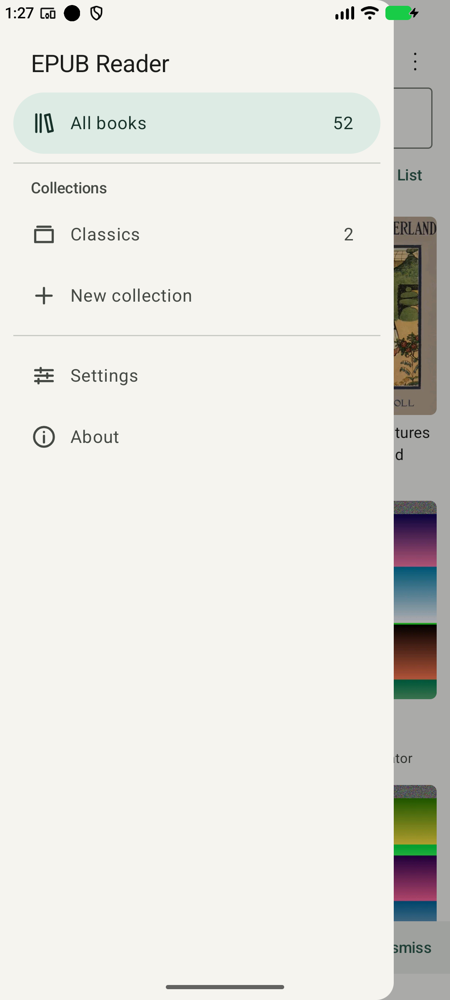
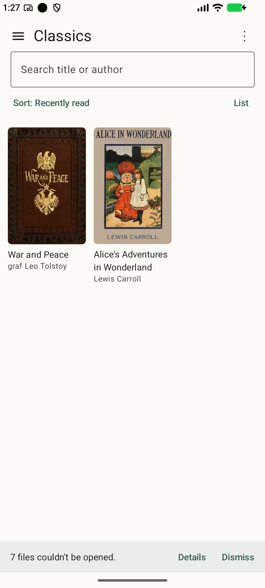

# M7 - Library management, backup, settings: milestone note

Branch `m7` (from master b37c0c1), Track B (C-035), emulator Medium_Phone (API 37, emulator-5554). Plan: master plan
`docs/plans/2026-10-30-mvp-plan.md`, section M7 (no separate step file, per the user's lighter process). Database
schema version **6** (AutoMigration 4 → 6; Track A holds 5).

| Drawer | Collection | Settings |
|---|---|---|
|  |  |  |

## Task checklist
- [x] 7.1 Navigation drawer, multi-select, collections (F-028, F-024, F-026): schema v6 (`collection`, `collection_book`)
- [x] 7.2 Delete, hide, un-hide (F-025)
- [x] 7.3 Folder view (F-017): tree, counts, include subfolders, empty state
- [x] 7.4 Backup and restore (F-090, R-009, C-011)
- [x] 7.5 Settings, about, privacy, app theme, discovery folder (F-100, F-092, F-110, F-074, F-011, C-007)
- [x] 7.6 Book details (F-015, F-021)
- [x] Deferred from M3/M4: cover staleness and orphan thumbnails, open-with grants that could not be persisted, `book_cache` rows deleted with their book
- [x] Final whole-branch review; Critical/Important fixed with pinning tests
- [ ] Full Must suite (C-034), full instrumented suite on the final code

## Must targets (final code)

BENCH_TABLE

## What works

Each item names its spec ID and the test that covers it.

- **Navigation (F-028):** the menu button opens a drawer with All books (count), Folders (when folder view is on),
  each collection (count) and New collection, Settings and About. Back closes the drawer, then ends a selection,
  then leaves a collection or folder, then leaves the app. Tests: `LibraryViewsTest`.
- **Multi-select (F-024):** long-press a book to start; taps add or remove books; the bar offers Select all, Add to…
  (a collection, or a new one), Delete, and in the overflow Remove from collection and Details. No export action
  (C-006). Tests: `LibraryViewsTest`, instrumented `CollectionsUiTest`.
- **Collections (F-026):** create (name required, unique ignoring case), rename, delete (books stay), add books with a
  searchable picker inside the collection, remove books. Rows are synced rows (id, `updatedAt`, tombstone; F-115).
  "Classics" with Alice and Frankenstein shows exactly those two: `CollectionsTest`, `CollectionsUiTest` (through the
  real screen).
- **Delete (F-025):** the dialog's "Also delete the file from the device" is off by default.
  - Library only: the book is hidden; scans keep it hidden; Settings → Hidden books → Show again brings it back.
  - With the file: every local copy is deleted, with its `book_cache` rows and thumbnail; reading data stays keyed by
    the book id, so the same book found later resumes. A file that cannot be deleted (or a `content://` copy) leaves
    the book hidden instead, and the message says so.
  - Tests: `DeleteHideTest` (F-025 checks), `CollectionsUiTest`.
- **Folder view (F-017, R-010):** Settings → Folder view adds Folders to the drawer: a tree mirroring the directories,
  each row with its book count (and how many are directly inside), same-named folders told apart by their parent
  path (`Books` and `Documents/Books`), folding per folder. A folder lists the books directly inside it, with the usual
  sort, layout and search, and a Subfolders switch. An emptied folder shows "No books in this folder" with All books.
  Folders without books vanish after a rescan (the tree is built from the library). Tests: `FolderTreeTest`,
  `LibraryViewsTest`.
- **Backup and restore (F-090, R-009, C-011):**
  - Settings → Back up now opens the system save dialog with `epub-reader-backup-YYYY-MM-DD.json`. The file is
    `{"format": "app.epubreader.backup", "version": 1, …}` with books (identity key and metadata, no paths), reading
    positions, collections and memberships, settings, and empty `bookmarks`/`highlights` arrays for M6.
  - Restore (Settings → Restore, or opening the file from a file manager) shows what the file holds, then merges in
    one transaction: books are matched by identity; for each item the newer change wins; newer tombstones delete;
    books not on the device are kept as pending identities and attach when a scan or open finds them; a discovery
    folder that does not exist here is not restored; foreign stamps are bounded (a day ahead) and the clock is
    seeded from all synced tables at every start.
  - Older files are upgraded by a migrations table keyed by version; a frozen v1 fixture must restore forever.
  - Tests: `BackupTest` (14), `BackupStateTest`, instrumented `BackupRestoreTest` (backup → clear every table →
    rescan → restore by opening the file → position, collection, hidden book and setting back).
- **Settings (F-100, C-007):** one screen built from a list of sections (`settingsSections`), so M5 and M6 add their
  entries there. Now: App theme (follow system / light / dark, applied at once, F-074), Where to look for books
  (everywhere, or one folder chosen with the system folder picker, F-011), Folder view, Hidden books, Page numbers
  (book / chapter), Back up now, Restore, About. Settings of features that do not exist yet (keep screen on,
  fullscreen, tap zones, volume keys, link confirmation, orientation lock, open last book, sync) are not shown.
  Choosing a folder offers to hide the books now outside it (reading data kept), then rescans. Tests:
  `SettingsStateTest`, `AppPrefsTest`.
- **About (F-092, F-110):** version, privacy points (no account, no network, no analytics, books never changed or
  uploaded), and the licences, rendered in the app from `docs/licenses.md` (copied into the assets at build time, so
  the list in the app is the audited one). Test: `LicenceTextTest`.
- **Book details (F-015, F-021):** cover, title, authors, language, added, last read, collections, every file the
  book is known under (a duplicate shows both paths, one entry), sizes, identity. Test: `BookDetailsTest`.
- **Deferred items done:**
  - Thumbnails are versioned per extraction; a book whose own file changed in place gets its cover looked up
    again; unreferenced thumbnails are swept after each cover pass (`ScannerTest.changed_in_place_forgets_the_cover`,
    `ThumbFilesTest`).
  - Open-with `content://` sources whose read grant could not be persisted are recorded for the session only and
    dropped at the next start; the book resumes when opened again (`LibraryRepositoryTest`).
  - `book_cache` rows go with their deleted book (`DeleteHideTest`).

## Final review (whole branch, separate reviewer) and fixes

Result: no Critical, 5 Important, 12 Minor. One Minor was re-graded to Important (privacy text). Every Important
finding was fixed with a test that failed first.

| # | Finding | Fix | Test |
|---|---|---|---|
| I-1 | Snackbar confirmations were cancelled as soon as they appeared (the F-025 "couldn't delete, hidden instead" was never readable) | One-shot message channel collected by one stable effect | `LibraryViewsTest.delete_selected_asks_ops_with_the_file_choice_and_reports` |
| I-2 | Restoring an older backup after a book's file changed in place moved the live book's position row onto a pending duplicate | Same stable id = same book; a position row id used by another book is never taken over | `BackupTest.restoring_an_older_backup_after_an_in_place_change_keeps_the_live_position`, `a_position_id_already_used_by_another_book_is_not_taken_over` |
| I-3 | Backup JSON parsed twice on the main thread, 64 MB cap | Parsed once on `Dispatchers.Default`, restored from the parsed file; cheap format check first; 16 MB cap | `BackupStateTest.parsing_happens_on_the_compute_dispatcher_once` |
| I-4 | Delete with files did file I/O and a thumbnail-folder listing per book on the main thread | Deletion on IO; the book's own thumbnail path is deleted, no listing | `DeleteHideTest.files_are_deleted_on_the_io_dispatcher` |
| I-5 | Restored stamps were forgotten at restart (local changes could lose to them); unbounded foreign stamps | `seedClock` from every synced table at start; stamps bounded to a day ahead; observe after the merge | `BackupTest.after_a_restart_local_changes_still_win_over_restored_stamps`, `absurd_future_stamps_are_bounded` |
| Minor → I | Privacy text promised link confirmation, which arrives with F-044 in M6 | Sentence removed until it is true | Checked in the About screen |

**Minors deferred** (full list in the review): confirmed work (backup write, restore, delete) runs in the activity's
scope, so finishing the activity mid-way can cancel it; export reads tables outside one read transaction; loading
states flash "book gone" / "0 files" for a frame; the library list is re-sorted on chrome-only changes; a selection
survives a new search; `FolderPaths` assumes user 0 (`/storage/emulated/0`); a restored rename can duplicate a local
collection name; the restore count includes the backup's own tombstoned books; a failure re-reading settings after a
successful restore is reported as a failed restore; turning folder view off while in it leaves the user there.

## Deviations from the plan

- **Execution:** inline (executing-plans), as in M3/M4: M7's tasks share the library state, one schema version and
  the navigation. One whole-branch review at the end. 7.1–7.3 landed as one commit (shared files).
- **No pending-identity table:** a restored book that is not on the device is a tombstoned `book` row that keeps its
  identity key; the scanner's identity match revives it.
- **`book.hiddenUpdatedAt`** (in v6): scans bump `book.updatedAt`, so hide/un-hide merges on its own stamp.
- **"Also delete the file" deletes every local copy** of the book (one entry = one book, F-015); the dialog shows the
  file count.
- **Bookmarks and highlights** do not exist before M6: the v1 file reserves the two arrays (written empty).
- **Library header:** Sort and List/Grid moved to a slim row under the search field, so a folder or collection name
  fits in the title.

## Questions for the gatekeeper

QUESTIONS

## How to try it

HOWTO
