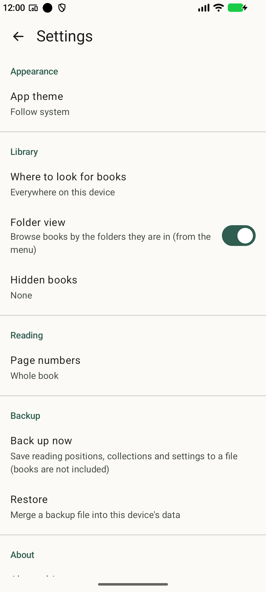

# M7 - Library management, backup, settings: milestone note

Branch `m7` (from master b37c0c1), Track B (C-035), emulator Medium_Phone (API 37, emulator-5554). Plan: master plan
`docs/plans/2026-10-30-mvp-plan.md`, section M7 (no separate step file, per the user's lighter process). Database
schema version **6**, rebased on master 9e76afb (M5, v5): AutoMigration 4 → 5 (M5) and 5 → 6 (M7).

| Drawer | Collection | Settings |
|---|---|---|
|  |  |  |

## Task checklist
- [x] 7.1 Navigation drawer, multi-select, collections (F-028, F-024, F-026): schema v6 (`collection`, `collection_book`)
- [x] 7.2 Delete, hide, un-hide (F-025)
- [x] 7.3 Folder view (F-017): tree, counts, include subfolders, empty state
- [x] 7.4 Backup and restore (F-090, R-009, C-011)
- [x] 7.5 Settings, about, privacy, app theme, discovery folder (F-100, F-092, F-110, F-074, F-011, C-007)
- [x] 7.6 Book details (F-015, F-021)
- [x] Deferred from M3/M4: cover staleness and orphan thumbnails, open-with grants that could not be persisted, `book_cache` rows deleted with their book
- [x] Final whole-branch review; Critical/Important fixed with pinning tests
- [x] Full Must suite (C-034) on 11ad479; rebased on master 9e76afb; `check`, instrumented suite (49/49) and the C-034 regression set on the rebased code

## Must targets (final code)

Full Must suite (C-034) on **11ad479** (all M7 code, before the rebase), then the C-034 regression set on the
rebased head **f4a0716**. Medians of 3, Must targets only (C-015). Results files are in `bench/results/`.

| Target | Must | Runs | Median | Result | Notes |
|---|---|---|---|---|---|
| P-001 cold start | 1200 ms | 853, 951, 919 | 919 | PASS | Quiet host. Earlier runs during `updatedb`: 958, 908 |
| P-002 hot start | 250 ms | 65, 136, 253 | 136 | PASS | Quiet host. During `updatedb`: 271, 260 (FAIL); see Q1 |
| P-003 open-with | 320 ms | 545, 202, 292 | 292 | PASS | Quiet host |
| P-010..P-013 open | 1500/1500/2000/2000 ms | 747/858/636/901 | | PASS | Re-run: 767/843/578/710 |
| P-015 tap → reader frame | 100 ms | 12 values | 33 | PASS | Re-run 27.5 |
| P-016 reopen score | 1.0 | 1.087, NA, 0.820 | 1.087 | FAIL → PASS | One recording failed to start (NA). Re-run: 0.795, 0.765, 1.545 → 0.795 |
| P-020 text size | 100 ms | 56, 108, 125 | 108 | FAIL | Re-run 144, 163, 68 → 144. Master measures the same (Q2) |
| P-021 exact total (W&P) | 5000 ms | 3385, 3586, 3364 | 3385 | PASS | Estimate error 0.59 % |
| P-022 rotation | 900 ms | 507, 1511, 2281 | 1511 | FAIL → PASS | App events 567–670 ms. Re-run: 504, 480, 1681 → 504 |
| P-026 boundary turn | 400 ms | 127, 104, 107 | 107 | PASS | 0 blank frames |
| P-030 TOC jump | 700 ms | 403, 467, 291 | 403 | PASS | |
| P-031 TOC panel | 200 ms | 51, 133, 132 | 132 | PASS | |
| P-050 first scan / first book | 7000 / 500 ms | 723, 626, 713 / 235, 347, 297 | 713 / 297 | PASS | 60 files |
| P-051 rescan, no changes | 300 ms | 152, 201, 295 | 201 | PASS | |
| P-052 rescan, 14 new | 1200 ms | 264, 262, 50 | 262 | PASS | |
| P-060 memory, W&P | 215 MB | 207, 206, 205 | 206 | PASS | Steady state (C-030). Right after the turns: 335 MB |

**C-034 regression set on the rebased code (f4a0716):**

| Target | Must | Runs | Median | Result |
|---|---|---|---|---|
| P-001 | 1200 ms | 988, 973, 981 | 981 | PASS |
| P-002 | 250 ms | 330, 344, 348 | 344 | FAIL: host load (Q1) |
| P-010 | 1500 ms | 742, 742, 770 | 742 | PASS |
| P-011 | 1500 ms | 757, 974, 798 | 798 | PASS |

The same run also gave P-003 315, P-012 895, P-013 733 and P-015 51 (all PASS), and P-016 1.103 (FAIL, one
recording failed again).

**A/B against master** (same session, same host load; T3 Code itself was using about 300 % CPU):
- P-002 hot start, 7 runs per block, alternating:
  - 11ad479 session: master b37c0c1 288 / 255 vs M7 268 / 289.
  - Rebased session: master 9e76afb 295 / 315 vs M7 280 / 279.
- P-020: master 9e76afb 143 vs M7 176. P-022: master 1645 vs M7 1895. Both builds FAIL both targets in this session.
- M7 changes neither hot start nor the reader. In the same session, these numbers follow the host, not the build.


## What works

Each item names its spec ID and the test that covers it.

- **Navigation (F-028):** the menu button opens a drawer with All books (count), Folders (when folder view is on),
  each collection (count) and New collection, Settings and About. Back closes the drawer, then ends a selection,
  then leaves a collection or folder, then leaves the app. Tests: `LibraryViewsTest`.
- **Multi-select (F-024):** long-press a book to start; taps add or remove books; the bar offers Select all, Add to…
  (a collection, or a new one), Delete, and in the overflow Remove from collection and Details. No export action
  (C-006). Tests: `LibraryViewsTest`, instrumented `CollectionsUiTest`.
- **Collections (F-026):** create (name required, unique ignoring case), rename, delete (books stay), add books with a
  searchable picker inside the collection, remove books. Rows are synced rows (id, `updatedAt`, tombstone; F-115).
  "Classics" with Alice and Frankenstein shows exactly those two: `CollectionsTest`, `CollectionsUiTest` (through the
  real screen).
- **Delete (F-025):** the dialog's "Also delete the file from the device" is off by default.
  - Library only: the book is hidden; scans keep it hidden; Settings → Hidden books → Show again brings it back.
  - With the file: every local copy is deleted, with its `book_cache` rows and thumbnail; reading data stays keyed by
    the book id, so the same book found later resumes. A file that cannot be deleted (or a `content://` copy) leaves
    the book hidden instead, and the message says so.
  - Tests: `DeleteHideTest` (F-025 checks), `CollectionsUiTest`.
- **Folder view (F-017, R-010):** Settings → Folder view adds Folders to the drawer: a tree mirroring the directories,
  each row with its book count (and how many are directly inside), same-named folders told apart by their parent
  path (`Books` and `Documents/Books`), folding per folder. A folder lists the books directly inside it, with the usual
  sort, layout and search, and a Subfolders switch. An emptied folder shows "No books in this folder" with All books.
  Folders without books vanish after a rescan (the tree is built from the library). Tests: `FolderTreeTest`,
  `LibraryViewsTest`.
- **Backup and restore (F-090, R-009, C-011):**
  - Settings → Back up now opens the system save dialog with `epub-reader-backup-YYYY-MM-DD.json`. The file is
    `{"format": "app.epubreader.backup", "version": 1, …}` with books (identity key and metadata, no paths), reading
    positions, collections and memberships, settings, and empty `bookmarks`/`highlights` arrays for M6.
  - Restore (Settings → Restore, or opening the file from a file manager) shows what the file holds, then merges in
    one transaction: books are matched by identity; for each item the newer change wins; newer tombstones delete;
    books not on the device are kept as pending identities and attach when a scan or open finds them; a discovery
    folder that does not exist here is not restored; foreign stamps are bounded (a day ahead) and the clock is
    seeded from all synced tables at every start.
  - Older files are upgraded by a migrations table keyed by version; a frozen v1 fixture must restore forever.
  - Tests: `BackupTest` (14), `BackupStateTest`, instrumented `BackupRestoreTest` (backup → clear every table →
    rescan → restore by opening the file → position, collection, hidden book and setting back).
- **Settings (F-100, C-007):** one screen built from a list of sections (`settingsSections`), so M5 and M6 add their
  entries there. Now: App theme (follow system / light / dark, applied at once, F-074), Where to look for books
  (everywhere, or one folder chosen with the system folder picker, F-011), Folder view, Hidden books, Page numbers
  (book / chapter), Back up now, Restore, About. Settings of features that do not exist yet (keep screen on,
  fullscreen, tap zones, volume keys, link confirmation, orientation lock, open last book, sync) are not shown.
  Choosing a folder offers to hide the books now outside it (reading data kept), then rescans. Tests:
  `SettingsStateTest`, `AppPrefsTest`.
- **About (F-092, F-110):** version, privacy points (no account, no network, no analytics, books never changed or
  uploaded), and the licences, rendered in the app from `docs/licenses.md` (copied into the assets at build time, so
  the list in the app is the audited one). Test: `LicenceTextTest`.
- **Book details (F-015, F-021):** cover, title, authors, language, added, last read, collections, every file the
  book is known under (a duplicate shows both paths, one entry), sizes, identity. Test: `BookDetailsTest`.
- **Deferred items done:**
  - Thumbnails are versioned per extraction; a book whose own file changed in place gets its cover looked up
    again; unreferenced thumbnails are swept after each cover pass (`ScannerTest.changed_in_place_forgets_the_cover`,
    `ThumbFilesTest`).
  - Open-with `content://` sources whose read grant could not be persisted are recorded for the session only and
    dropped at the next start; the book resumes when opened again (`LibraryRepositoryTest`).
  - `book_cache` rows go with their deleted book (`DeleteHideTest`).

## Final review (whole branch, separate reviewer) and fixes

Result: no Critical, 5 Important, 12 Minor. One Minor was re-graded to Important (privacy text). Every Important
finding was fixed with a test that failed first.

| # | Finding | Fix | Test |
|---|---|---|---|
| I-1 | Snackbar confirmations were cancelled as soon as they appeared (the F-025 "couldn't delete, hidden instead" was never readable) | One-shot message channel collected by one stable effect | `LibraryViewsTest.delete_selected_asks_ops_with_the_file_choice_and_reports` |
| I-2 | Restoring an older backup after a book's file changed in place moved the live book's position row onto a pending duplicate | Same stable id = same book; a position row id used by another book is never taken over | `BackupTest.restoring_an_older_backup_after_an_in_place_change_keeps_the_live_position`, `a_position_id_already_used_by_another_book_is_not_taken_over` |
| I-3 | Backup JSON parsed twice on the main thread, 64 MB cap | Parsed once on `Dispatchers.Default`, restored from the parsed file; cheap format check first; 16 MB cap | `BackupStateTest.parsing_happens_on_the_compute_dispatcher_once` |
| I-4 | Delete with files did file I/O and a thumbnail-folder listing per book on the main thread | Deletion on IO; the book's own thumbnail path is deleted, no listing | `DeleteHideTest.files_are_deleted_on_the_io_dispatcher` |
| I-5 | Restored stamps were forgotten at restart (local changes could lose to them); unbounded foreign stamps | `seedClock` from every synced table at start; stamps bounded to a day ahead; observe after the merge | `BackupTest.after_a_restart_local_changes_still_win_over_restored_stamps`, `absurd_future_stamps_are_bounded` |
| Minor → I | Privacy text promised link confirmation, which arrives with F-044 in M6 | Sentence removed until it is true | Checked in the About screen |

**Minors deferred** (full list in the review): confirmed work (backup write, restore, delete) runs in the activity's
scope, so finishing the activity mid-way can cancel it; export reads tables outside one read transaction; loading
states flash "book gone" / "0 files" for a frame; the library list is re-sorted on chrome-only changes; a selection
survives a new search; `FolderPaths` assumes user 0 (`/storage/emulated/0`); a restored rename can duplicate a local
collection name; the restore count includes the backup's own tombstoned books; a failure re-reading settings after a
successful restore is reported as a failed restore; turning folder view off while in it leaves the user there.

## Deviations from the plan

- **Execution:** inline (executing-plans), as in M3/M4: M7's tasks share the library state, one schema version and
  the navigation. One whole-branch review at the end. 7.1–7.3 landed as one commit (shared files).
- **No pending-identity table:** a restored book that is not on the device is a tombstoned `book` row that keeps its
  identity key; the scanner's identity match revives it.
- **`book.hiddenUpdatedAt`** (in v6): scans bump `book.updatedAt`, so hide/un-hide merges on its own stamp.
- **"Also delete the file" deletes every local copy** of the book (one entry = one book, F-015); the dialog shows the
  file count.
- **Bookmarks and highlights** do not exist before M6: the v1 file reserves the two arrays (written empty).
- **Library header:** Sort and List/Grid moved to a slim row under the search field, so a folder or collection name
  fits in the title.

## Questions for the gatekeeper

### Q1 – P-002 depends on host load more than on the build
- On a quiet host (after `updatedb` finished): 136 ms (PASS).
- On the rebased code, with T3 Code at about 300 % CPU: 344 ms. Master measured 295–315 ms in the same session.
- **Proposed:** accept the quiet-host run, and re-run `start` on a quiet host before the merge, as C-024/C-028 say.

### Q2 – P-020 fails on master too
- M7: 108, then 144 on the re-run. Master 9e76afb, same session: 143.
- M7 does not touch the reader or the display panel. C-031 already accepted a re-run for M4.
- **Proposed:** keep C-031: confirm P-020 on the real device in M9.

### Q3 – Bookmarks and highlights in backups
- They do not exist until M6. F-090's check ("highlights return") can only be met then.
- The v1 file reserves the `bookmarks` and `highlights` arrays (written empty).
- **Proposed:** M6 defines the entries additively within version 1 (unknown keys are ignored), and the
  highlight part of the F-090 check is verified in M6.

### Q4 – The app opens every JSON file
- "Opening a backup file from a file manager offers restore" needs a VIEW filter for `application/json`. The app
  therefore appears in "Open with" for every JSON file.
- A non-backup file shows "This file isn't a backup from this app" and changes nothing.
- **Proposed:** accept.

### Q5 – Search history (M5) in backups
- F-090 does not list it, and it is device-local (not a synced row).
- **Proposed:** keep it out of backups.

### Q6 – Process: builds during Track A benchmarks (reported)
- I ran short Gradle builds while `/tmp/epub-reader-bench-running` existed, at about 23:55 and again at
  00:21–00:24 (the second time a full `--rerun-tasks` compile).
- Track A results from those windows may be noisy.
- Since then every build goes through a wrapper that waits for the flag.

### Q7 – Intermittent M5 test
- `core:search` `ensureBuilt_racing_a_delete_starts_no_build` failed once in `./gradlew check` on the rebased tree.
- It passed 3/3 alone, and the module is unchanged on this branch.
- **Proposed:** Track A looks at the race in M6.

### Q8 – Dev installs of the pre-rebase branch
- A device with this branch's pre-rebase v6 database crashes on start (Room identity hash mismatch). The emulator
  hit it before `pm clear`.
- No user build carried it.
- **Proposed:** no migration; clear app data on dev devices.


## How to try it

The M7 debug build is installed on Medium_Phone with all-files access; the library is scanned.
- **Navigation:** the menu button (top left) opens the drawer: All books, collections, New collection, Settings, About.
- **Collections:**
  1. Long-press a book, tap more books.
  2. Tap **Add to…** → **New collection**, name it.
  3. Open it from the drawer. Its ⋮ menu has Add books, Rename and Delete collection.
- **Delete:** select books → trash icon. "Also delete the file" is off by default; without it the books are only
  hidden (Settings → Hidden books → Show again).
- **Folders:** Settings → Folder view on, then drawer → Folders. Tap a folder; the Subfolders switch includes nested
  books. ⋮ on a selected book → Details lists every copy.
- **Backup:** Settings → Back up now (save dialog, dated name). Settings → Restore, or open the `.json` from Files.
- **Theme:** Settings → App theme → Dark applies at once.
- From a terminal (fish), offer a restore from a backup file on the device:
  ```fish
  adb shell am start -a android.intent.action.VIEW -t application/json -d file:///sdcard/Download/epub-reader-backup-2026-11-01.json -n app.epubreader/.MainActivity
  ```

