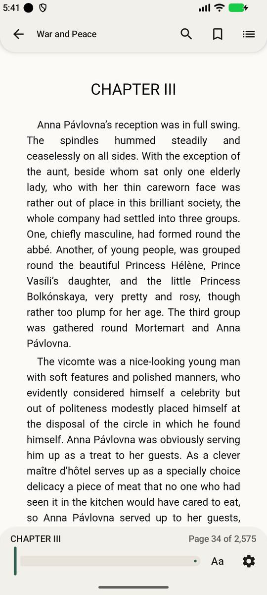
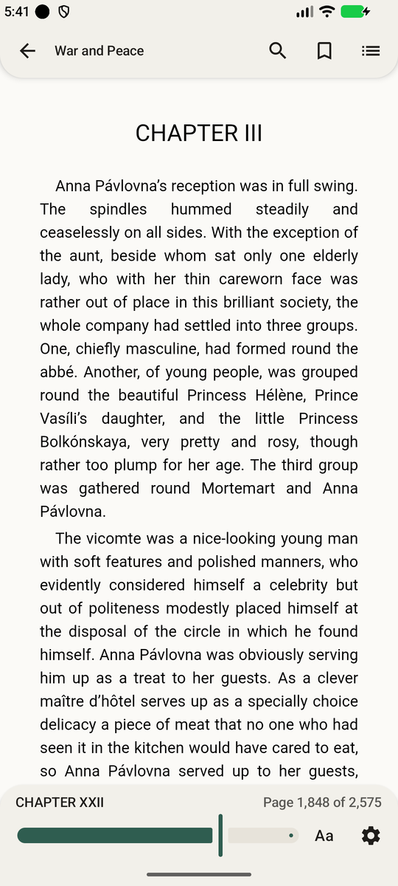

# M9 - Release: milestone note

## Part A (Track A, branch `m9a` from master acc47c4)

Emulator Medium_Phone (API 37, emulator-5554), shared with Track B under C-035. Plan: master plan
`docs/plans/2026-10-30-mvp-plan.md`, section M9 (no separate step file). No schema change (Track B owns v8).

| linear-algebra with Noto Sans Math (C-047): brackets stretch to the matrix height |
|---|
|  |

### Checklist
- [x] C-049 faster instrumented suite: one shared activity for the reader tests, IdentityAgreementTest without layout
- [x] C-049 order-dependent `FileReplacedUnderReaderTest.replaced_by_rename`: cause found and fixed (not retried)
- [x] C-049 / M6 Q7 P-022 harness: the recording waits for the exact page total of the current layout
- [x] 9.1 robustness suite R-001..R-010 (instrumented tests + `bench/robust_r005.sh`, `robust_r006.sh`, `robust_r009.sh`)
- [x] C-048 clear "no readable sections" / "No package found in this file" messages, R-003 single-OPF fallback
- [x] R-008 bug found by the suite and fixed: changes on shared storage were not noticed
- [x] C-047 Noto Sans Math for `math` elements, outside the font override; docs/licenses.md (About screen)
- [x] Regression benchmarks P-001, P-002, P-010, P-011 (C-034)
- [x] Whole-branch review; Critical/Important fixed with pinning tests; `./gradlew check`; full suite green twice

### Robustness suite (Task 9.1) on this branch

Instrumented classes in `app/src/androidTest/.../robustness/` (debug build) plus scripts in `bench/` (benchmark build).
R-005 and R-006 ran against the huge chapter **unchunked** (master before M8); the gatekeeper re-runs them after M8.

| Check | How | Result | Notes / fixes |
|---|---|---|---|
| R-001 damaged book opens | `MalformedBooksTest.the_partly_damaged_book_opens_and_reads` | PASS | good chapters and the bad-XML chapter show text; TOC entry to the missing file: notice, page stays; missing anchor: stays (allowed) |
| R-002 unrecoverable files | `MalformedBooksTest` scan + open-with of each corpus malformed file | PASS after fix | scan: each reported with its reason, scan completes; open-with: clear message, Back returns. Fixed (C-048): empty spine showed the raw script error "Cannot destructure property 'parentNode'…", now "This book has no readable sections." |
| R-003 missing container | same tests + Vitest | PASS after fix | single-OPF fallback added to the reader (first `.opf` in name order, like the scanner); none: "No package found in this file." (was "Failed to load container file") |
| R-004 fake EPUB | scan test (`fake.epub` from the folder set) | PASS | reported NOT_A_ZIP, every other file still scanned (`files` count) |
| R-005 Back ≤ 200 ms | `bench/robust_r005.sh` (benchmark build), `HugeChapterBackTest` (debug guard) | PASS | 119, 123, 106 ms → **119** (back command → first library frame), no ANR. Debug guard: ~270 ms, all library composition (see Q1) |
| R-006 50 turns per stress book | `bench/robust_r006.sh` (after review I2: every turn must land, first paint required) | PASS | 0/50 turns missed per book, no process death, same pid, no renderer crash. Peak PSS app+renderer: huge chapter **1520 MB** (first paint 12 s, unchunked; earlier run 1275), 2000 chapters 336 MB, 200 images 377 MB. P-061/P-062 are Task 9.2 (Q3) |
| R-007 degrade gracefully | `DegradeGracefullyTest` (+ corpus script-test in M6) | PASS | scripts (inline, DOMContentLoaded, onload) off; broken font and stylesheet ignored; unsupported video/object; book lays out and turns |
| R-008 file changed under the reader | `FileReplacedUnderReaderTest` (cache dir and **shared storage**) | PASS after fix | new shared-storage cases failed: FUSE gives no inotify events for changes made through it. `FileWatch` now also checks the path once a second |
| R-009 kill loop | `bench/robust_r009.sh` (after review I3: two turns per kill, kill 0/50/200/500 ms after the turn) | PASS | 20 iterations: lag 0 in 20/20 (the first, one-turn version also 20/20) |
| R-009 old backup | `BackupRestoreTest.an_old_version_1_backup_restores` | PASS | the frozen v1 fixture (M7) restored through open-with on the device: collection and setting back |
| R-010 paths and names | `FolderSetTest` | PASS | 11 placed folder books (space + non-ASCII folder, `.hidden`, `.nomedia`, `Android/media`, `UPPER.EPUB`, 3-level nesting…) found, titled, folder shown, opened |

### C-049 instrumented suite

| Run | Code | Tests | Wall | Result |
|---|---|---|---|---|
| Baseline | master acc47c4 | 82 | **755 s** | 80/82: `replaced_by_rename` (NO_ACCESS on first open), `deleted` (timeout) |
| Before the review fixes | 7e2e4a5 | 92 | 527 s / 501 s | 91/92 (HighlightsTest clicked the sliding selection toolbar: fixed with `settled`), then 92/92 |
| Final run 1 | 3c2059b | 92 | **506 s** | **92/92**, host load 4 |
| Final run 2 | 3c2059b | 92 | **614 s** | **92/92**, host load 8-9 (Track B building during the run) |

All runs: `am instrument` after `pm clear`, all-files access, one launch to scan, corpus pushed (`bench/push_corpus.sh`).
The final runs pass `--no-window-animation` (window animations off for the run only, no global setting changed; for
Gradle the same through `testOptions`). The suite now has 10 more tests (robustness classes, shared-storage R-008,
FileWatchTest, old-backup restore). On a quiet host it takes a third less time (506 s and 501 s against 755 s, -33 %);
under load it is slower (614 s, -19 %). Comparing only the 82 original tests, the per-test sum fell from 752 s to 467 s (final
run 1, -38 %; it includes the OpenWithTest case moved into MalformedBooksTest).

What made it faster:
- **IdentityAgreementTest** (105 s → 4.5 s): reads each corpus book's identifier through the web side's package load
  (`__readerTest.identify`, the same `identifierOf` that `opened` reports) instead of opening and rendering ~40 books.
- **UiAutomator idle wait off** (`SuiteSetup`, registered for every run through the test manifest's `listener`
  meta-data): every `findObject`/`wait` waited for 500 ms of accessibility quiet, which the reader's WebView rarely
  gives (0.5-1.1 s per call). Clicks on things that animate in now wait for the node to stand still
  (`UiDevice.settled`); this cured the one failure the change caused (HighlightsTest clicked the selection toolbar
  while it slid in).
- **Window animations off for the run**: the runner finishes the activity after every test and waits for it to stop
  (~1 s per test, mostly the close animation).
- One duplicate removed (OpenWithTest's malformed files are covered by MalformedBooksTest, plus a 0-byte file).

Not done, and why: a library or activity **shared across tests**. AndroidJUnitRunner's `ActivityFinisherRunListener`
finishes every activity before and after each test (`MonitoringInstr: Finishing activity`), and it can't be turned
off; a shared activity was tried and reverted (no gain, misleading code). The library is prepared once per run (one
scan after `pm clear`); BackupRestoreTest, the only class that clears tables, restores it in `@AfterClass`.

**The order-dependent failure (C-049).** Logcat of the failing run: `ReaderController: open: opening the file failed:
java.io.IOException: close failed: EIO`. `BookOpener` keeps the last closed book open as the "warm" session; the
next open closes it. The warm book was from BackupRestoreTest/CollectionsUiTest, in a `/sdcard/Download/...` folder
that test's `@After` had deleted; on FUSE the close of a deleted file fails with EIO, and the exception escaped
`open()`, so the unrelated next book failed as NO_ACCESS. It passed alone because then nothing else was warm. Fix:
retired sessions are closed with the failure caught and logged (unit test `a_failing_close_of_the_warm_session…`,
RED → GREEN). The device run now logs `closing …/r8-sd-rename.epub failed: EIO` harmlessly.

**P-022 harness (M6 Q7).** `bench/groups/action.sh` waits for `page_total_exact` of the current layout (new
`wait_ev` in `bench/lib.sh`) before each rotation recording, so the label's "≈ N" → exact change no longer falls in
the pre-roll.

### C-047 math font

Noto Sans Math (SIL OFL 1.1, Noto Project Authors, with an OpenType MATH table; `assets/reader/fonts/noto-sans-math.ttf`,
~1 MB) for `math` elements; the reader's font override excludes `math, math *`. In docs/licenses.md, which is the
About screen's licence list. linear-algebra (screenshot above): the brackets of the 3×5 matrix and the 3×1 vector
now stretch to their full height; M6 (`M6-checks/mathml.png`) showed them at text size.

### Regression benchmarks (C-034)

Benchmark build of **3c2059b**, quiet host (Gradle stopped, no ffmpeg, device panel closed for `start`; load 3),
`/tmp/epub-reader-bench-running` set, medians of 3 (C-015).

| Target | Must | Runs | Median | Result | Notes |
|---|---|---|---|---|---|
| P-001 cold start | 1200 ms | 880, 710, 910 | **880** | PASS | |
| P-002 hot start | 250 ms | 403, 221, 101 | **221** | PASS | first run high (bimodal on this emulator, M1/M2 notes) |
| P-010 open (Alice) | 1500 ms | 733, 909, 830 | **830** | PASS | re-run: 730, 748, 768 → 748 |
| P-011 open (War and Peace) | 1500 ms | 762, 859, 852 | **852** | PASS | re-run: 875, 752, 918 → 875 |

Recorded alongside: P-003 293 ms; P-012 602/590; P-013 997/867; P-015 37/28; P-016 1.117 (FAIL) and on the rule's
single re-run 0.89 (PASS); M7 saw the same flip. Results in `bench/results/20261101T0635*-3c2059b.jsonl` and
`…T064356Z-3c2059b.jsonl`.

### Whole-branch review

A fresh reviewer read `acc47c4..81c0f54`: no Critical findings, four Important ones. All four were fixed, plus one
Minor that I re-graded as Important by its effect on users:
- **I1** The reader's fallback for a missing package differed from the scanner when `container.xml` existed but was
  unusable (wrong-case or missing `full-path`, no oebps media type, broken XML). The book was added to the library but
  could never be opened, and the reader said "No package found". Fix: the web side reads the container leniently and
  applies the scanner's rule (ContainerParser + `ZipReader.entry` resolution), then always gives foliate a container
  naming that package. 6 new Vitest cases (RED → GREEN).
- **I2** `robust_r006.sh` passed a book that never painted or never turned. It now fails on no paint, on a turn that
  doesn't land, or on a renderer crash line.
- **I3** `robust_r009.sh` could not tell "saved on every page change" from "saved on close". It now turns two pages
  per kill, kills 0/50/200/500 ms after the turn, and accepts lag ≤ 1 only.
- **I4** `robust_r005.sh`'s header overstated what it measures. Corrected: the clock starts when the command runs on
  the main thread; main-thread stalls are reported by the debug test.
- **Minor → Important:** FileWatch could deliver a change noticed just before `stop()` after it, closing the book
  opened next. `FileWatchTest.a_change_noticed_before_stop_is_not_delivered_after_it` RED → GREEN.

Deferred minors (not fixed, listed for the gatekeeper):
- **FileWatch:** the poll treats an mtime-only change (`touch`) as a change on shared storage, while the inotify path
  ignores ATTRIB on the same inode. Kept, because an in-place rewrite such as `adb push` keeps the inode.
- **`PfdSource.close()`:** if the channel close throws, the pfd close is skipped (a StrictMode warning only).
- **`packageProblem`:** a broken OPF keeps the parser message as the detail line.
- **Math CSS:** the rule sets the font on `math` only; a book rule that sets `font-family` on math descendants beats
  inheritance.
- **Test manifest:** `android:targetPackage="app.epubreader"` is hard-coded; re-check it when the applicationId
  changes.
- **Test leftovers:** library rows for `/sdcard/Download/r8-test` books remain after FileReplacedUnderReaderTest.
  `r-*.epub` copies remain in `cacheDir/testbooks`. The appops grant is never reset.
- **DegradeGracefullyTest** does not assert the media placeholder or the computed fallback font.
- **The old-backup test** checks a collection and a setting, not a position (the fixture's books aren't on the
  device).

### Questions for the gatekeeper

- **Q1 R-005 method.** *Answered (accepted): timing from the `back` command reaching the main thread.* Debug-build
  numbers (~270 ms) are library composition (sampled main-thread stacks).
- **Q2 R-003 with several `.opf` files or an unusable container.** The spec says "a single .opf". Default used: the
  scanner's existing rule (first `.opf` in name order), so the reader and the scanner always agree on the book's
  identity. Alternative: report such a file instead.
- **Q3 R-006 memory.** The huge chapter, unchunked on this master, peaks at 1.2-1.5 GB PSS (app + renderer); its first
  paint takes 12 s. No process death on the emulator, but P-061 (400 MB peak, C-053) needs M8's chunking. Proposed:
  re-run `robust_r006.sh` and `robust_r005.sh` after M8 merges; Task 9.2 gates P-061/P-062.
- **Q4 C-049 "shared fixtures".** A shared activity is impossible under AndroidJUnitRunner (see above). The library
  is prepared once per run and restored by the one class that clears it. Proposed: accept as is.
- **Q5 R-009 "older backups".** Only format version 1 exists. The device test restores the frozen v1 fixture written
  by M7 (`core/data/src/jvmTest/resources/backup/v1.json`, shared with the JVM test, never copied).

### Deviations
- R-005 is judged on the benchmark build (Q1). The debug instrumented test is a 1 s guard.
- The ReaderWebView Back-key change tried while diagnosing R-005 was reverted. On API 33+ the key never reaches the
  view hierarchy (predictive back), so it would have been unverified code.
- `OpenWithTest.malformedEachFile` was folded into MalformedBooksTest.

## Part B: performance (Track B, branch `m9-perf` from master bff018d)

### Checklist
- [x] C-062 P-061 peak: split measured, counter batches capped by size; bench `mem --release` gates P-061.peak/steady
- [x] C-063 P-022 re-measured with M9a's harness, same-session A/B (no fix needed)
- [x] C-066 P-020 records command -> painted next to the video value (`P-020.cmd_painted`, info target)
- [x] C-069 web unit tests on fake timers (deterministic under load)
- [x] C-071 boundary turns slide (both ways, LTR/RTL, any input); P-026 = input -> first slide frame
- [x] C-079/C-080 scroll mode stable: jumps land and stay, no snap-back, sections ahead of the viewport
- [x] Whole-branch reviews (three passes), Critical/Important fixed with pinning tests
- [x] Benchmarks (C-034 + P-014, P-020, P-021, P-022, P-023, P-026, P-061), `./gradlew check`, full instrumented suite

### C-062: where the P-061 peak came from, and the fix
Memory trace of the first open of the huge chapter, sampled every ~0.3 s (PSS, app process and WebView renderer):

| Build | App process (chunking) | Renderer | Total peak |
|---|---|---|---|
| master (bff018d) | 120 -> 156-164 MB for ~2 s | 68 -> 432-434 MB while counting, held ~27 s | 568 MB |
| batches capped at 512 KB | 121-172 MB | 213 MB | 335 MB |
| (tried) capped at 256 KB | 169 MB | 168 MB | 289 MB, but the exact total took 8.5 s instead of 5.0 s |

Chunking itself is cheap. The peak was the page counter: it built hidden batch documents of 24 chunk parts (~3 MB of
markup each), and the renderer kept that memory for ~30 s. `batches()` now cuts a batch document at 24 sections or
512 KB of markup (by foliate's `section.size`, the uncompressed entry size); the sample's counts are still sent as one
message. R-006 on the huge chapter: peak 556 -> 368 MB. War and Peace chapters (~9 KB) still go 24 at a time.

### C-063: P-022 rotation
Same session, M9a's harness (the label shows the exact total before each recording), 6 runs per build, interleaved:
m9-perf 430 ms, master 437 ms, pre-M6 3487f72 436 ms (median; Must 900). The 1732 ms of M8 was the old harness's clock
(it started ~1 s early on reruns). No fix needed.

### C-071: boundary slide
A turn into the preloaded neighbour section used to swap it in instantly (a shortcut from the S2 spike). Now the old
page is pinned where it was on screen and both pages move one width over 300 ms with the in-section easing; the turn
stays locked until the slide ends, so the host's turn queue keeps later swipes (C-026). "No animation" keeps every turn
instant. The review caught that the leaving page had dropped to the iframe's default 150 px height during the slide;
the device test now samples both pages' on-screen size every frame (it fails with "was 150" on the old style).

### C-079/C-080: scroll mode, root cause
Scroll mode stacks sections in one scroller (M4). It was only tested with slow drags on books without images. Three
causes, all in the paginator's stack mode, explain the user's recordings:
1. **Contents jumps landed one section early.** A jump to a section shorter than the screen (Acknowledgements,
   Introduction) was clamped by the end of the scroll range, so the viewport top fell into the section before it, and
   the stack's "follow the section at the top" made that section current. Each retry landed a little earlier (Manager's
   Path video: 99 -> 96 -> ... -> 58). Scroll events caused by the reader's own inserts and evictions during a jump could
   also make an old section current.
2. **Snap-back while scrolling.** Every resize of the current document (images decoding, fonts) re-applied the last
   anchor, which is only refreshed 250 ms after scrolling stops: an image-heavy book was pulled back again and again
   (Grokking video); after a jump it was pulled back to the jump target.
3. **Scrolling stopped at a chapter end.** The stack only grew when the section at the viewport top changed, so a long
   section followed by a short one ran out at the short one's end.

Why the flows differed: in Pages mode a section is laid out alone and positioned by page, so neither the scroll range
nor a neighbour's height can move it; only stack mode depends on the heights of several sections and on scroll events.

Fix: one deliberate-navigation path (`#goTo`: contents, search hit, link, bookmark, highlight, slider, resume) that in
stack mode drops the old sections and suppresses following, stack work and 'scroll' relocates until it has settled
(`#jumps`); a jump's anchor is re-applied only until the user's first gesture, after which a resize keeps the element at
the viewport top in place (`#holdScreen`); sections are loaded ahead of the viewport both ways, chaining through short
sections (`#ensureStack`); and a pad after the stack (one screen while more follows, just enough at the book's end) so a
short target can reach the top.

Tests: `ScrollStabilityTest` samples the position every frame during drags and flings (technical book with images,
illustrated short chapters, War and Peace, after a Contents jump) and fails on any backward movement or a falling page
label; Contents jumps far back and forward (and to the last entry) must land and stay 3 s.
`NavigationInBothFlowsTest` runs every deliberate navigation (Contents, search hit, link + Back, bookmark, highlight,
slider, resume) in Pages and in Scroll mode with the same rule (deviation: one new parameterised class instead of
parameterising each older test class). Real-device steps: `docs/real-device-pass.md`.

### Results on the final code (4d6604e app code, 2026-11-02, emulator Medium_Phone, quiet host)

Device tests: the scroll/navigation/boundary/input set **33/33** (NavigationInBothFlowsTest 14, ScrollStabilityTest 7,
ScrolledFlowTest 2, ReaderBoundaryTest 4, PageTurnInputTest 6). Full instrumented suite: **115/116** in 875 s; the one
failure, `LinksFootnotesTest.the_aside_note_opens_a_popup_and_a_tap_outside_closes_it` (a 5 s timeout), passes when its
class runs alone (5/5 twice): order-dependent, reported, not chased. `./gradlew check` green (core:epub 151, core:data
118, core:search 50, ui 185, app 120, lint); web tests 275/275.

| Id | Must | Result | Verdict |
|---|---|---|---|
| P-001 | 1000 | 732 (rerun 662) | PASS |
| P-002 | 250 | 230 (rerun 307 at load 2.7, bimodal as before) | PASS on the quiet host |
| P-010 / P-011 | gate | 696 / 617 | PASS |
| P-012 / P-013 / P-016 | gate | 672 / 688 / 0.988 | PASS |
| P-014 huge chapter | 3000 | 541 | PASS |
| P-015 | 100 | 161; same session: master bff018d 149, this branch 146 | FAIL for both builds: emulator state after the host reboot (C-039), not this branch |
| P-020 | 100 | 96 (command -> painted 108, info) | PASS |
| P-021 | 5000 | 3404, estimate error 0.42 % | PASS |
| P-022 | 900 | 282 | PASS |
| P-023 huge chapter | 3000 | 387 | PASS |
| P-026 | 400, no blank | 114 input -> first slide frame (slide end 395-612), 0 blank frames | PASS |
| P-030 / P-031 | gate | 381 / 70 | PASS |
| P-060 | 215 | 202, 199 (master 207, same session) | PASS |
| P-061 peak / steady | 400 / 300 | 336, 310, 319 / 205 (cold first opens, chunk cache cleared) | PASS |

Measurement fix: the mem group sampled every process named after the package, so right after a force-stop the previous
run's exiting WebView renderer was counted too. That produced one P-061 peak of 499 MB (traced cold first opens: 292-331)
and the P-060 "regression" (224-239 MB on master and the branch). `mem.sh` now waits until the old processes are gone;
P-060 is 199-207 MB on both builds (Q-B1 answered: no app regression, no bisect needed).

Earlier on this branch: P-022 A/B 430 / master 437 / pre-M6 436 ms; P-061 568 -> 335 MB first-open peak with the counter
cap.

### Gatekeeper answers (Part B)
- **Q-B1** P-060: a measurement artifact (above), not a regression; the bench is fixed.
- **Q-B2** Memory: while the emulator runs, one Gradle build at a time across both tracks, with `-Dorg.gradle.jvmargs=-Xmx2g`
  or `--no-daemon`; wait while `free -g` shows under 4 GB available; never stop Gradle daemons. Followed for every build
  after the OOM kill.
- **Q-B3** Top-to-bottom vertical books keep instant boundary turns: accepted for the MVP (vertical-rl books use
  `vertical-pages` and slide).

## Part B: release (Track A, branch `m9b` from master bff018d)

### Checklist
- [x] C-054 rename to FernReader: display name, applicationId `app.fernreader` (play + fdroid), backup format id
      `app.fernreader.backup` (old id still restores), backup file name, About/privacy text, README, bench/test scripts
- [x] Original adaptive launcher icon (fern frond, vector, monochrome layer)
- [x] `app.epubreader` (and `app.epubreader.test`) uninstalled from the emulator (C-044)
- [ ] 9.2 P-044 MARKERWORDHUGE (`bench/groups/search.sh --release`)
- [ ] 9.2 P-062 50 plates of the 200-image book (`bench/groups/mem.sh --release`)
- [ ] 9.2 P-063 `seedLibrary 1000` + visual scroll check, covers from the thumbnail cache
- [ ] 9.2 P-031 TOC panel open, 2000 entries
- [ ] 9.2 whole-corpus page-count agreement and "≈" within ±5 % (`CorpusPageCountTest`), incl. vertical per-chapter totals
- [ ] 9.2 P-043 re-measured on linear-algebra (C-068)
- [x] 9.3 `checkFdroidClean`, `fdroid` release from a clean checkout, no network permission (runtime check on the device pending)
- [x] 9.3 licence audit (docs/licenses.md), signing left to the user (documented)
- [ ] 9.3 Baseline Profile decision (C-039)
- [x] docs/release-checklist.md, docs/real-device-pass.md, `bench/device_pass.sh`
- [x] F-031 user report: Reading mode also in the Reader settings sheet and Settings → Reading; animation greyed out in Scroll
- [x] C-072 Scroll looked "condensed": cause found and fixed (paginator, see below), tests, before/after screenshots
- [x] C-073 reader controls: title in the top bar (2 lines, details dialog), chapter + page row above the slider, live drag preview
- [ ] C-074 folders in the navigation drawer
- [x] C-075 rescan on return to the foreground / when a library view shows; manual rescan cost (device re-check pending)
- [x] C-076 new books on top of "recently read" (device re-check pending)
- [ ] C-077 icon top bar for library views, pull-to-refresh
- [ ] Rebased onto Track B's merged branch; two consecutive green `bench/run_all.sh all --release`
- [ ] `./gradlew check`, full instrumented suite
- [ ] Whole-branch review; Critical/Important fixed with pinning tests

### Reading mode in three places (F-031, user report)

"Reading mode: Pages / Scroll / Auto" was only in the display panel. It is now also in the Reader settings sheet
(above "Page-turn animation") and in Settings → Reading (above the animation). All three edit the one stored
`ReaderSettings.flow` through `ReaderController.updateSettings`, so a change anywhere shows everywhere. In Scroll mode
the page-turn animation is disabled (greyed out) with the hint "Applies to page mode" in the sheet and in Settings; Auto
keeps it enabled (it pages in portrait, C-004). Tests: `SettingsEntriesTest` (listed, edits `flow`, disabled + hint in
Scroll only; JVM) and `ReadingModeSyncTest` (device: sheet → panel → Settings → sheet and panel, green twice).
Test note: after scrolling the display panel, UiAutomation's node cache kept the old rows (Compose sends no scroll
event there); the test clears it (`UiAutomation.clearCache()`, API 34+).

**Superseded by C-084:** Reading mode is again only in the display panel (Aa); the sheet row and the Settings →
Reading item (`reader.flow`) are removed. The Scroll-mode greying of the page-turn animation stays (C-084 doesn't
change it). `SettingsEntriesTest.reading_mode_is_not_listed` (JVM) and `ReadingModeSyncTest` (device: no row in the
sheet or Settings; Scroll chosen in the panel greys the animation in both; Pages restores it).

### C-085: Chapters "Continuous / One at a time" in scroll mode

Display panel, directly under Reading mode, shown only while the book scrolls (Scroll, or Auto in landscape):
**Chapters: Continuous / One at a time** (`ReaderSettings.scrollChapters`, stored with the display settings; values
stored before it decode to Continuous; `WebSettings.chapters`). Continuous is C-079/C-080 unchanged.

One at a time is the paginator's `chapter-stop` attribute (PATCHES.md): stack mode stays on (jumps, holding the text
in place, C-080) but holds only the current section, so scrolling stops at its last line. Right below it a
"Next: <title>" button, right above it "Previous: <title>" (the chapter's contents entry, or the entry before it;
texts from Copy via `open`; none at the book's first/last linear section). The button or a deliberate overscroll pull
(during one touch, the finger travels at least max(96 CSS px, 20 % of the viewport) past the scroller's end or top;
a flick that runs into the end does not count) opens the adjacent chapter as a jump: the next at its top, the
previous at its end. Every other jump (contents, search, links, Back, bookmarks, highlights, slider, resume) is the
same code path in both settings. Switching between the two keeps the text on screen (no re-anchoring; only the
neighbours come or go). Page numbers are unaffected.

Split documents (M8, gatekeeper decision): the parts of a huge document the app split are one chapter. `open` carries
`continued` (the virtual sections that are a later part, `ChunkMap.continuedSections`); the paginator stacks a chapter's
parts like Continuous does and puts the controls only before its first and after its last part
(`ChaptersOneAtATimeChunkedTest` on stress-huge-single-chapter.epub; Vitest `chapterSpan`).

Tests: Vitest `chapters.test.ts` (pull detection, labels), `reader.test.ts` (attribute set before `flow`, labels from the
contents and the app's texts), `protocol.test.ts`; JVM `ReaderSettingsTest`, `ProtocolFixtureTest`,
`ReaderControllerTest`, `ScrollChaptersRowTest`; device `ChaptersOneAtATimeTest` (8) and `NavigationInBothFlowsTest`
with a third parameter (Scroll + One at a time).

### C-072: Scroll looked "horizontally condensed"

| Pages, before | Scroll, before | Pages, after | Scroll, after |
|---|---|---|---|
|  |  |  |  |

War and Peace, portrait, default settings (justified by the book's CSS), same passage. Measured in the WebView
(`__readerTest.typography`, Medium_Phone, viewport 411 CSS px): font family, size, weight, letter and word spacing,
line height and alignment were **identical**; no transform or zoom on the root or the iframe; `-webkit-text-size-adjust`
auto in both; one word rendered 36.815 px wide in both (no text autosizing or font boosting); the font stylesheet
from styles.ts applies in both. Only the **text column** differed: Pages 329.1 px from x = 41.1, Scroll 320 px from
x = 45.7, so lines broke differently from the 4th line on (the user's screenshots: x≈90–810 vs 100–800 of 900 px).

**Cause.** F-072's margin is foliate's `gap` attribute (2m %). In paged flow foliate places the page container
between two half-gap grid columns (g/2 of the width each) and pads the document by half its column gap
(g / (1 − g) × container / 2): text inset = g × width per side (41.1 px). In scrolled flow the container spans the
full width and foliate pads the document by the whole `gap`, g / (1 − g) × width per side (45.7 px): the same
setting gave a ~1.1 % narrower inset per side. Not a double padding, not a scrollbar gutter.

**Fix (paginator touched, layout path only).** `reader-web/vendor/foliate-js/paginator.js`, scrolled branch of
`#beforeRender`: horizontal text gets paged flow's inset, read from the hidden `#probe` (where the paged container
sits) plus half of paged flow's column gap (`scrolledInlineInset`, PATCHES.md row 2026-11-01 C-072). Vertical writing
in scrolled flow is unchanged. The `gap` attribute and paged geometry are untouched, so the page counter (which uses
`pagedLayout` in either flow, C-002) and Track B's C-071 boundary-slide work in the paged path are not affected.
After: both modes 329.14 px from x = 41.14, identical line starts.

Tests: `reader-web/test/paginator.test.ts` (inset = paged text inset for 5 viewport/margin cases + the measured one),
`FlowTypographyTest` (device: one W&P paragraph in both flows at default settings and at the report's settings —
justified, 1.5, 5 %; compares computed styles, transforms/zoom, a word's width, column width and left edge (±1 px)
and the first word of every line). RED before the fix (column 329.1 vs 320, line starts differ), GREEN after.

### F-Droid build, network, licences, signing (Task 9.3)

- **Clean checkout:** `git clone ~/Projects/epub-reader -b m9b` into an empty directory (no `local.properties`, no
  `node_modules`, own project cache dir), `ANDROID_HOME` set, `./gradlew --no-daemon :app:checkFdroidClean
  :app:assembleFdroidRelease` at 77f8d6f: `checkFdroidClean: OK`, build OK in 2 min 53 s; the only network use is
  Gradle/Maven dependency resolution and `npm ci` (reader-web build tools). Output
  `app-fdroid-release-unsigned.apk` (8.9 MB), unsigned by design (`apksigner`: no signature).
- **No network:** the merged manifest of the `fdroid` (and `play`) build has **no `INTERNET` permission**, so the app
  process cannot open sockets (the kernel enforces it), WebView included. Permissions: MANAGE_EXTERNAL_STORAGE,
  READ/WRITE_EXTERNAL_STORAGE (old APIs), and WorkManager's WAKE_LOCK, ACCESS_NETWORK_STATE (reads connectivity
  state only; no network constraint is used), RECEIVE_BOOT_COMPLETED, FOREGROUND_SERVICE. The privacy text now says
  "It has no network permission." A runtime check (per-uid traffic stats while reading) is listed for the release run.
- **Licences:** docs/licenses.md audited against the 164-module `fdroidReleaseRuntimeClasspath`: all Apache-2.0
  (MIT-compatible); fonts SIL OFL 1.1; foliate-js MIT; icon our own. Found and fixed: `material-icons-core` was missing,
  WorkManager was marked "not yet used". The repo had no LICENSE file: added (MIT).
- **Signing:** no key created. Release builds sign only when the user supplies `fernreader.signing.*` properties or
  `FERNREADER_SIGNING_*` variables (`app/build.gradle.kts`); docs/release-checklist.md §5 has the steps.

### C-073 reader controls

| Before | After | Dragging the slider |
|---|---|---|
|  |  |  |

Top bar: the book title only (2 lines, then ellipsized); tapping it opens a small dialog with the full title and
author(s) (Back, outside tap or Close). Bottom bar: chapter name (start, one line) and page indicator (end) on one
row, slider below. Dragging previews the target: the web side's `opened` message now carries each section's size
(the numbers foliate maps a slider fraction with), `SeekPreview.sectionAt/tocEntryAt` repeat that mapping, and
`PageTotals.previewAt` gives the page with the live counts/estimates. On release the preview stays until the seek
lands; a cancelled drag (Back during it, or the controls going away) clears it and nothing moves (Material's slider
commits even a lifted touch, so "cancel" is Back/dismiss). In sections with several TOC entries (~6 % of W&P), where
the entries start is unknown before layout: the current entry if already in that section, else an even split, so the
preview may name the neighbouring entry there. Tests: `SeekPreviewTest` (9), `PageTotalsTest` (+2),
`ReaderControllerTest` (+3), Vitest (+1), device `ControlsTitleSeekPreviewTest` (3 tests, green 3×: drag shows the
target's TOC title and page before release and lands there; Back cancels; Frankenstein's title takes 2 lines, a very
long one stays at 2 and the dialog shows it in full). `BookmarksTest`/`TocJumpTest` got node-cache clears and a tap
retry (stale cache after tab switches; a first tap after open sometimes lost).

### C-075 rescan on return, C-076 new books on top

**Cause (confirmed on the emulator with the pre-fix build).** (1) The resume scan ran only when the library screen was
on top: returning to the reader, settings or details, then Back to the library, scanned nothing. (2) On the library it
did run, but a never-opened new book sorted last under "recently read", below the screen (C-076). (3) Manual and
automatic scans both listed every folder of shared storage (a stat per file over FUSE), so every non-book file made
both slower.

**Fix.** Every return to the foreground scans (any screen; `app_foreground` event); the library and its views report
when they come into view (`onViewShown`; no debounce since the m9b-tests fix: a view shown within 2 s of a scan used to skip its scan and miss a book copied in between); a request during a scan queues one more; automatic scans
show no progress unless they find something (`ScanState.showsProgress`). `FileStorageWalker` remembers each folder's
listing for the process lifetime and reuses it while the folder's mtime is unchanged (one stat), still checking book
files' size/date; a listing made within 2 s of the folder's change is not trusted; the first scan after start walks
everything. C-076: "recently read" sorts by max(lastOpenedAt, addedAt); a book that left the library and is found
again gets a new addedAt (a move within one scan keeps it). Collections: recency is the book's own, not the membership
stamp (a sync stamp, also bumped on removal). No schema change.

**Measured** (emulator, benchmark build, 5,000 small files in 110 folders under /sdcard/ScanNoise next to the corpus,
`bench/scan_noise.sh`, app's `scan_complete ms`, 5 rounds): manual rescan 354 → **12 ms** median; scan on return
780 → **106 ms**. Instrumented: a book copied into a new nested folder while the app is in the background shows on
top 405 ms after return.

**Tests.** `FileWalkerCacheTest` (4), `ScanControllerTest` (+4), `LibraryStateTest` (+2), `ScannerTest` (+1); device
`ScanOnReturnTest` (3: return → book on top within 2 s with its folder in the tree; open folder view gets the new book
on top; opening a folder view scans) passed 3/3 alone once; one failure in the library package run was traced to
`BackupRestoreTest` leaving the sort at "author" (reset added). Device re-runs are pending until Track B is done.
`bench/device_pass.sh return` and a docs/real-device-pass.md row time "copy, return, book visible" on a phone.
`SettingsReaderItemsTest` broke with the extra Reading mode row (items below the first screen, stale node cache):
fixed (explicit drags + cache refresh), device re-run pending.

### Known C-016 exceptions (gatekeeper: accepted for this release)

The "≈ N" estimate shown before the exact screen-page total must be within ±5 % (C-016). `CorpusPageCountTest`
(whole corpus, default settings, emulator) measured two exceptions, unchanged when every section is counted alone,
so they come from the estimator (S1 text model), not from the counter:

| Book | Exact total | Worst estimate error (runs) |
|---|---|---|
| jlreq-in-japanese.epub | 792–805 | 31.6–33.8 % (baseline before M9 part B: 29.9 %) |
| linear-algebra.epub | 1,051–1,123 | 5.99–9.04 % (8.28 % with the C-003 self-check; baseline: 7.39 %) |

No estimator work in this release; Book pages (C-083) is the default numbering and does not use the estimate.
Also in docs/release-notes.md (known issues).

### C-003 counter self-check (gatekeeper option 1)

moby-dick.epub and jlreq-in-japanese.epub counted a few sections differently in the shared batch document than the
paginator shows (cause inside the batch document unknown). Now each shared batch also counts its **largest** section
(markup size; longer sections show a layout difference first; one extra alone count per batch) alone in a foliate
View (`checkSection`/`selfCheck`, counter.ts). If the two differ, the batch's other sections **and every section earlier
batches of this layout counted in a batch document** are recounted alone (their counts overwrite the ones sent), and
the rest of the book is counted alone. The decision is cached per open book: later layouts of that book count alone
from the start. Needed: jlreq's checks pass until section 157 (last batch), while 4/40/68 in earlier batches were off.
Corpus: only moby-dick (found at section 6, the sample) and jlreq fall back to alone.

Tests: Vitest +7 (345 total); device `CounterSelfCheckTest` 2/2 (exact total after 8.0 s moby-dick, 16.0 s jlreq);
`CorpusPageCountTest` passed, 0 mismatches in every book (jlreq 33.79 % and linear-algebra 8.28 % estimate errors
reported as "(known)", accepted C-016 exceptions). Same session, benchmark builds, emulator: **P-021** median 3612 ms (a4b1aa7: 4069/3612/3427) → **4266 / 4361 ms**
(two runs: 3618/4271/4266, 4503/4361/4243), PASS ≤ 5 s; the cost is one alone count per 24-section batch (~16 for War
and Peace). Open (tap_book → painted_first, median of 5, `c083/open.sh`): P-010 494 → 541, P-011 597 → 695, P-014
580 → 540 ms (spread 311–885 in both builds; the count starts after the first paint, so this is noise).

**Fix (HugeChapterChunkTest flaky):** a section that shares its batch document with no other section (a batch of one,
e.g. the unchunked 10 MB chapter; or a key no other section of the batch has) is now counted alone only. Before, it was
laid out in the batch document and then again alone by the self-check, with both layouts alive at once: on the
emulator the renderer peaked at ~399 MB instead of ~280 MB (d481bd9), free memory fell to ~80 MB with swap full, the
control's jump took 9–11 s instead of 4.7 s, and the activity teardown afterwards took 20 s to many minutes (the
test's failures). Now: jump 3.1–3.6 s, renderer peak 267–297 MB, test 30 s, 3/3. The count is the same (6277).
Vitest `planBatch`/`PageCounter batch mode`.

### Questions for the gatekeeper (Part B)

- **QB1 Build during Track B's bench.** My first unit-test build (15:02, ~30 s) started a minute after Track B created
  `/tmp/epub-reader-bench-running` (15:01) — I had not checked the marker. Every later build waits for the marker
  (`while [ -e /tmp/epub-reader-bench-running ]`). Track B's results from 15:01–15:03 may have seen that load.
